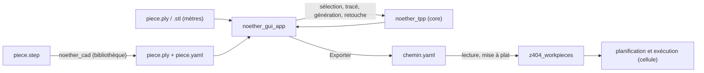

# Spécifications du fork Noether (Zone 404)

**Plateforme :** Zone 404
**Paquets :** `noether_cad` (bibliothèque C++ et ligne de commande ; aucun en-tête ROS dans le code), `noether_gui` (application Qt/VTK `noether_gui_app`), `noether_tpp` (bibliothèque de planification de chemins d'outil)
**Stack :** Noether 0.16.0 (ROS-Industrial), OpenCASCADE, VTK, PCL, Qt 5, yaml-cpp, Eigen
**Langue spec :** français | **Langue code :** anglais
**Versions :** V1 (existant), V1.1 (implémentée), puis V1.2… (ajouts à venir, chacun dans sa section)
**Statut :** V1 implémentée et testée, branche `z404/open-step`, commit `2dd5dfe` ; V1.1 implémentée et testée le 01/11/2026 (§25)

---

## Comment lire ce document

Ce document est la spécification du fork Zone 404 de Noether : ce que nos ajouts font, ce
qu'ils refusent, et comment on le vérifie. Il ne décrit pas Noether d'origine, documenté
dans `docs/` (Doxygen) et sur le site du projet.

Il est découpé par version. La section **V1** décrit le code tel qu'il existe. Chaque ajout
de spec à venir prend une section **V1.1**, **V1.2**, etc., à la suite, sans réécrire V1 :
une règle de V1 remplacée y est barrée, avec un renvoi vers la version qui la remplace.

Les README des paquets (`noether_cad/README.md`, `noether_gui/README.md`) restent le mode
d'emploi détaillé. En cas de désaccord entre un README et ce document, ce document fait
foi et le désaccord se signale.

Les décisions sont numérotées `N1`, `N2`… dans le journal (annexe A). Les trous connus,
ce que le code ne tranche pas, sont dans l'annexe B.

---

## Table des matières

- [V1 : existant](#v1--existant)
  - [1. Contexte et rôle](#1-contexte-et-rôle)
  - [2. Vocabulaire](#2-vocabulaire)
  - [3. Principes directeurs](#3-principes-directeurs)
  - [4. Architecture générale](#4-architecture-générale)
  - [5. Conversion STEP (`noether_cad`)](#5-conversion-step-noether_cad)
  - [6. IHM : fenêtre et outils](#6-ihm--fenêtre-et-outils)
  - [7. Sélection des surfaces](#7-sélection-des-surfaces)
  - [8. Tracé manuel et génération](#8-tracé-manuel-et-génération)
  - [9. Retouche du chemin](#9-retouche-du-chemin)
  - [10. Couverture](#10-couverture)
  - [11. Fichiers produits](#11-fichiers-produits)
  - [12. Ajouts de `noether_tpp` hors IHM](#12-ajouts-de-noether_tpp-hors-ihm)
  - [13. Matrice d'erreurs](#13-matrice-derreurs)
  - [14. Structure des paquets et intégration](#14-structure-des-paquets-et-intégration)
  - [15. Critères d'acceptation](#15-critères-dacceptation)
  - [16. Résumé V1 / suite](#16-résumé-v1--suite)
- [V1.1](#v11)
  - [17. Vocabulaire ajouté](#17-vocabulaire-ajouté)
  - [18. Le chemin livré devient une liste de poses éditée](#18-le-chemin-livré-devient-une-liste-de-poses-éditée)
  - [19. Outil « Éditer les points »](#19-outil--éditer-les-points-)
  - [20. Supprimer des points](#20-supprimer-des-points)
  - [21. Densifier par pas ou par nombre](#21-densifier-par-pas-ou-par-nombre)
  - [22. Cube de navigation](#22-cube-de-navigation)
  - [23. Matrice d'erreurs V1.1](#23-matrice-derreurs-v11)
  - [24. Questions ouvertes V1.1](#24-questions-ouvertes-v11)
  - [25. Critères d'acceptation V1.1](#25-critères-dacceptation-v11)
  - [26. Ce que V1.1 remplacera dans V1](#26-ce-que-v11-remplacera-dans-v1)
- [Annexe A : journal des décisions](#annexe-a--journal-des-décisions)
- [Annexe B : trous connus](#annexe-b--trous-connus)

---

# V1 : existant

## 1. Contexte et rôle

Le fork sert à préparer, sur la CAO d'une pièce, le chemin d'un outil de ponçage à
disque, puis à l'exporter pour la cellule. Le chemin est dessiné par un opérateur : V1 ne
calcule pas de raster automatique depuis l'IHM.

### Ce qu'il fait

- Convertir un STEP en maillage en mètres, avec l'unité lue dans le fichier et une
  finesse imposée par l'appelant.
- Ouvrir une pièce STEP, PLY ou STL dans une IHM bilingue (français, anglais).
- Choisir des surfaces sur la pièce, face par face, avec quatre outils de sélection.
- Tracer à la main, sur chaque surface, la ligne que suit le centre de l'outil.
- Générer une passe par surface tracée : poses de contact au pas demandé, une pose
  d'approche et une de retrait.
- Retoucher le chemin : déplacer des poses, densifier un tronçon, réordonner et supprimer
  des passes, annuler.
- Mesurer et afficher la part de la surface atteinte par le disque.
- Exporter le chemin livré (poses), retouches appliquées.

### Ce qu'il ne fait pas

| Tâche | Responsable |
| --- | --- |
| Recaler la pièce réelle et transformer les poses dans le repère du robot | `z404_sdg_placement`, la vision (`scan3d`) |
| Lire le chemin exporté et le mettre à plat pour la planification | `z404_workpieces` (`tool_path.py`) |
| Calculer les articulations, vérifier l'atteignabilité et les collisions du robot | planification de la cellule (Tesseract) |
| Choisir la vitesse, l'effort et le réglage de la ponceuse | arbre de comportement et configuration de la cellule |
| Réparer ou décimer une géométrie CAO | hors périmètre (`noether_cad` §9) |
| Retirer les poses que l'outil n'atteint pas sans traverser la pièce | personne en V1 : `OcclusionModifier` existe mais n'est pas branché (§12, annexe B) |

### Invariants vérifiables

| Invariant | Vérification |
| --- | --- |
| Un STEP sans entité `LENGTH_UNIT`, ou avec plusieurs unités, est refusé | `StepReader.ParsesLengthUnitEntity`, `StepReader.ForcedUnitStillNeedsFileUnit` |
| Les déflexions de maillage n'ont pas de valeur par défaut ; nulle, négative, infinie ou NaN est refusée | `StepReader.RefusesInvalidDeflections`, `StepImport.RefusesMissingKeys`, `StepImport.RefusesNonFiniteOrNonNumeric` |
| Le recentrage est une translation pure, écrite dans la fiche YAML | `StepReader.RecentersOnBoundingBox` |
| Chaque pose de contact a son axe z sur la normale de la face et son axe x dans le sens de marche | `TraceTool.PosesFollowTheNormalAndTheTravel`, `TraceTool.StraightensTheTravelAgainstATiltedNormal` |
| L'approche et le retrait sont à la hauteur demandée le long de l'axe z de la première et de la dernière pose de contact | `TraceTool.ApproachAndRetractStandAboveTheEnds`, `TraceTool.ApproachFollowsATiltedToolAxis` |
| Une passe livrée porte au moins 4 poses ; sinon l'export est refusé | `ToolPathRecipe.ValidationRefusesAPassShorterThanTheContract`, `PathEditWidget.ReportsAPassTooShortToDeliver` |
| La recette n'invente aucune pose : toute pose livrée vient de la génération, d'un déplacement ou d'une densification enregistrés | `ToolPathRecipe.NoWaypointIsInventedByTheHandEdit` pour la recette seule ; revue de `assemblePasses` pour les déplacements et insertions, non testés sur ce point |
| Un fichier de retouche de version supérieure à 3 est refusé | lecture de `readRecipeFile`, `ToolPathRecipe.RefusesAMalformedRecipeFileNamingIt` |
| L'approche et le retrait ne comptent pas dans la couverture | `FaceCoverage.TheApproachAndDepartureDoNotCount` |
| Les textes de l'IHM (onglets, outils, options, boîtes de dialogue) existent en français et en anglais | `Translator.*`, `ProcessRibbon.Translates` ; exceptions listées en §6.4 |

## 2. Vocabulaire

| Terme | Définition |
| --- | --- |
| pièce | le maillage chargé dans la vue, en mètres |
| face | un triangle du maillage. À ne pas confondre avec la **face CAO**, surface du STEP dont plusieurs triangles proviennent |
| sélection en cours | les faces choisies et pas encore validées, dessinées en orange |
| surface | un ensemble de faces d'un seul tenant, validé, qui porte au plus un tracé et produit au plus une passe |
| tracé | la polyligne posée à la main sur une surface, que suit le centre de l'outil |
| pose | position et orientation de l'outil : z sur la normale de la face, x dans le sens de marche. Pour un STEP, la normale sort de la matière (`noether_cad`) ; pour un PLY ou un STL, son sens est celui du fichier, l'IHM ne la réoriente pas |
| pose de contact | une pose posée sur la pièce, qui ponce |
| approche, retrait | la pose hors contact devant la première et derrière la dernière pose de contact d'une passe |
| passe | une suite continue de poses, approche et retrait compris, que l'outil parcourt sans quitter la pièce |
| génération | les passes produites par **Générer**, avant toute retouche |
| retouche | ce que l'opérateur change après la génération : ordre, suppressions, poses déplacées, poses ajoutées |
| recette | la forme déclarative d'une retouche, tenue en mémoire par l'IHM (`PathEditWidget`) |
| chemin livré | la génération à laquelle la retouche est appliquée ; c'est ce qu'exporte **Exporter** |
| couverture | la part de l'aire des surfaces que le disque atteint en suivant le chemin |

Termes proscrits : « trajectoire » pour une passe (la trajectoire du robot est calculée
ailleurs) ; « segment » pour une passe dans le texte destiné à l'opérateur (c'est le nom de
la passe dans le code, `ToolPathSegment`). Le mot reste employé, dans l'aide du tracé, au
sens géométrique d'une ligne droite entre deux sommets.

## 3. Principes directeurs

1. **Rien de deviné.** L'unité d'un STEP est lue dans le fichier, la finesse du maillage
   et la hauteur d'approche sont données par l'appelant, la tolérance de comparaison d'une
   recette est passée par l'appelant. *Conséquence :* un STEP sans fichier de finesse est
   refusé à l'ouverture (§5), et aucune de ces fonctions n'a d'argument par défaut.
2. **L'opérateur dessine le chemin.** En V1, **Générer** transforme le tracé en poses, il
   ne planifie pas de raster. *Conséquence :* une surface sans tracé ne produit rien, et
   le rapporte (§8).
3. **Une passe ne s'interrompt pas.** L'outil ne quitte pas la pièce au milieu d'une
   passe. *Conséquence :* une surface donne une seule passe ; une sélection en plusieurs
   morceaux est refusée (§7).
4. **La retouche est déclarative.** Elle se tient en recette, pas en suite d'actions.
   *Conséquence :* Annuler revient à l'état précédent sans rejouer d'actions, et une
   recette appliquée à une autre génération est détectée par les empreintes des passes (§9).
5. **Une IHM, deux langues.** *Conséquence :* chaque texte passe par la classe
   `Translator` ; un texte calculé est recalculé au changement de langue, sauf les
   exceptions de §6.4.

## 4. Architecture générale



Frontières :
- `noether_cad` n'expose aucun type OpenCASCADE ; l'IHM et `noether_tpp` ne voient que des
  triangles.
- L'IHM n'écrit rien dans le repère du robot. Les poses exportées sont dans le repère du
  maillage, en mètres. Pour un STEP, c'est le repère recentré dont la translation est
  écrite dans `piece.yaml` (`T_source_output`).
- Le chemin exporté ne porte ni vitesse, ni effort, ni outil.

## 5. Conversion STEP (`noether_cad`)

La règle complète est dans `noether_cad/README.md` ; ce qui suit en est le contrat.

| Règle | Motif |
| --- | --- |
| L'unité est lue dans l'entité `LENGTH_UNIT` de la section DATA ; absente ou multiple : refus | une unité devinée donne une pièce mille fois trop grande ou trop petite, sans erreur |
| Mise en mètres **avant** le maillage | une déflexion en mètres appliquée à un modèle en millimètres donne un maillage mille fois trop fin |
| `linear_deflection_m` et `angular_deflection_rad` obligatoires, strictement positives et finies | la finesse est un choix d'ingénierie : trop grossière, la corde passe sous la surface |
| Un fichier à plusieurs solides est refusé si l'appelant n'a pas choisi (`solids: one`) | l'outil ne choisit pas à la place de l'opérateur |
| Recentrage par translation pure vers le centre de la boîte englobante des triangles, écrite dans la fiche | sans elle, ce qui est mesuré sur la pièce réelle ne se rattache plus au maillage |
| Chaque triangle garde l'identifiant de sa face CAO | sélectionner une face CAO revient à extraire un intervalle de triangles |
| Le `.ply` et le `.yaml` déjà présents sous le même préfixe sont remplacés sans confirmation | la conversion est rejouable à l'identique |

Dans l'IHM, la finesse vient d'un fichier YAML passé au lancement (`--step-tessellation`,
`-s`), relu à chaque ouverture :

```yaml
linear_deflection_m: <mètres>
angular_deflection_rad: <radians>
solids: all          # ou one
```

Le PLY et sa fiche s'écrivent à côté du STEP. L'IHM n'impose jamais l'unité.

## 6. IHM : fenêtre et outils

### 6.1 Disposition

Barre du process en haut (onglets et outils), arbre à gauche, vue 3D au centre, options à
droite, barre d'état en bas. La barre d'outils et le dock de configuration du pipeline
d'origine sont cachés ; leurs actions restent dans les menus. Schéma et classes :
`noether_gui/README.md` §1.

### 6.2 Onglets

| Onglet | Outils | Options |
| --- | --- | --- |
| 1 Fichier | Ouvrir une pièce, Reprendre un chemin | formats acceptés, finesse STEP |
| 2 Sélection | Région, Brosse, Polygone, Gomme, Valider la surface | angle de planéité, diamètre de la brosse |
| 3 Traitement | Tracé manuel, Générer, ~~Déplacer des points, Densifier~~ Éditer les points (V1.1, §19) | pas du tracé, hauteur d'approche, rayon de l'outil, ~~pas cible de densification~~ sélection de points et Densifier (§19.5, §21) |
| 4 Trajectoire | Ordre des passes, Exporter | liste des passes : monter, descendre, supprimer, annuler ; rétablir (V1.1, §18) |
| Affichage | Calques, Vues standard, Langue | disques pleins, surélévation, zones non couvertes ; vues face, dessus, côté, iso ; cube de navigation dans la vue (V1.1, §22) |

Règles :
- Les outils qui prennent la souris dans la vue s'excluent : en choisir un relâche le
  précédent.
- Un outil de sélection est toujours armé. Tracé manuel, ~~Déplacer des points et Densifier~~
  Éditer les points (V1.1, §19) sont temporaires : ils rendent la souris au dernier outil
  de sélection quand on change d'outil, ~~quand on valide la disposition,~~ ou quand on
  entre dans les onglets Fichier, Trajectoire ou Affichage.
- Changer d'onglet ne lance aucune action, sauf : l'onglet Sélection reprend le dernier
  outil de sélection, l'onglet Traitement active le Tracé manuel.

### 6.3 Gestes de vue

| Geste | Effet |
| --- | --- |
| clic droit et glisser | tourner, quel que soit l'outil |
| Alt + clic gauche et glisser | tourner, avec un outil qui utilise le glisser |
| molette | zoom |

### 6.4 Langue

Français par défaut, anglais au choix (Affichage, Langue), gardé dans `QSettings` (clé
`language`, valeurs `fr`, `en`). Ne changent pas de langue : le titre de la fenêtre, un
message déjà affiché dans la barre d'état, les messages d'erreur des bibliothèques (dont
les défauts de retouche de `noether_tpp`, en anglais seul), et la ligne « N poses » de la
liste des passes, en français seul (annexe B).

### 6.5 Valeurs à l'ouverture

| Réglage | Valeur | Source |
| --- | --- | --- |
| diamètre de la brosse | 30 mm | `kDefaultBrushDiameterMm` |
| angle de planéité (Région) | 20° | `kDefaultFlatnessAngleDeg` |
| pas du tracé | 20 mm | `kDefaultTraceStepMm` |
| hauteur d'approche et de retrait | 50 mm | `kDefaultApproachHeightMm` |
| rayon de l'outil | 62,5 mm (disque de 125 mm) | `kDefaultToolRadiusMm` |
| pas cible de densification | 10 mm | `kDefaultDensifyStepMm` |
| surélévation des disques dessinés | 2 mm | `kDefaultDiscLiftMm` |

Ce sont des valeurs de départ de champs que l'opérateur modifie, pas des valeurs par
défaut d'une fonction (principe 1). Elles sont dans
`noether_gui/src/widgets/tpp_widget_defaults.h`.

## 7. Sélection des surfaces

| Outil | Règle |
| --- | --- |
| Région | depuis la face cliquée, ajoute les faces voisines par une arête tant que l'angle entre la normale d'une face et celle de sa voisine reste sous l'angle de planéité. Ne traverse pas les faces d'une surface déjà validée |
| Brosse | ajoute les faces à moins d'un demi-diamètre, en distance mesurée le long de la surface (`facesWithinGeodesicRadius`), pas à vol d'oiseau. Le glisser est échantillonné pour ne pas laisser de pointillés |
| Polygone | clics successifs dans la vue ; Entrée ferme le contour, Retour arrière retire le dernier sommet, Échap efface. Ajoute les faces dont le centroïde projeté est dans le contour |
| Gomme | retire des faces de la sélection en cours. Avec Maj, Brosse et Polygone effacent au lieu d'ajouter. Région n'a pas d'effacement par Maj : un clic sur une zone orange la retire, avec ou sans Maj |

**Valider la surface** transforme la sélection en cours en surface. Elle est refusée si
la sélection est vide, ou faite de plusieurs morceaux non reliés par une arête (principe 3).

Dans l'arbre :
- **Reprendre** remet les faces de la surface dans la sélection en cours ; son tracé est
  perdu.
- **Supprimer** retire la surface et son tracé.
- Une **case décochée** dessine la surface comme des faces libres ; elle est toujours
  générée.

**Rognage à l'affichage.** Avec « Rayon de l'outil » coché, une surface est dessinée
rognée du rayon d'outil le long des bords où une face voisine monte au-dessus d'elle
(un relief que le disque heurterait). Ce rognage ne change que l'affichage : il ne retire
aucune face de la surface et ne change pas la génération.

## 8. Tracé manuel et génération

**Tracé manuel.** Il s'applique à la surface courante de l'arbre. Le premier clic pose le
départ ; chaque clic ou chaque glisser ajoute un sommet au point de relâche. Retour arrière
retire le dernier sommet, Échap efface le tracé. Les mêmes actions existent en boutons.

**Générer.** Pour chaque surface qui a un tracé d'au moins deux sommets :

1. la polyligne est échantillonnée au pas du tracé, en reportant la longueur d'arc d'un
   segment au suivant ; le premier et le dernier sommet sont toujours gardés
   (`sampleTrace`) ;
2. chaque point est projeté sur la surface, avec la normale de la face touchée ;
3. chaque pose prend z sur la normale et x dans le sens de marche rendu orthogonal à z
   (`tracePoses`) ;
4. une pose d'approche et une de retrait sont ajoutées à la hauteur d'approche, le long de
   l'axe z de la première et de la dernière pose de contact (`withApproachAndRetract`).

Une surface donne une passe. Une surface sans tracé ne donne rien et la liste des
surfaces concernées est affichée. Une sélection en cours non validée bloque la génération.

~~Si le chemin porte une retouche, une nouvelle génération demande confirmation : elle la
perd, parce qu'elle renumérote les passes.~~ V1.1 : confirmation quand le chemin est
modifié (§18). Si la génération échoue en cours de route, tout
le résultat partiel est effacé, pour ne pas afficher ni exporter un chemin amputé.

## 9. Retouche du chemin

### 9.1 Déplacer des points

**Remplacé en V1.1 par l'outil Éditer les points (§19).**

~~Le glisser d'une pose de contact la déplace sur la pièce : z suit la normale de la face
sous le curseur, x garde son sens de marche rendu orthogonal. Si la pose déplacée est la
première ou la dernière de contact, l'approche ou le retrait la suit, à la même place dans
son repère. Un clic à plus de 50 mm de toute pose ne saisit rien (`kGrabToleranceM`).
L'approche et le retrait ne se saisissent pas. **Annuler** défait un glisser entier.~~

### 9.2 Densifier

**Remplacé en V1.1 par Densifier par pas ou par nombre (§21).**

1. ~~Choisir deux poses de contact A et B de la même passe (clic à moins de 50 mm).~~
2. ~~Régler le pas cible.~~
3. ~~Cliquer **Densifier**.~~

~~Chaque écart entre deux poses voisines, de A à B, plus long que le pas cible, reçoit des
poses régulièrement réparties, posées sur la surface de la passe selon §21.1 (en place
depuis le 01/11/2026). Les poses existantes ne bougent pas. Redensifier le même écart
remplace les poses ajoutées. Densifier demande la pièce ouverte, et une passe dont la
surface est connue : un chemin repris est refusé, même avec sa pièce (N23). Un écart sans
triangle valable est sauté, et la barre d'état donne le nombre d'écarts sautés. Les poses
ajoutées ne suivent pas un déplacement ultérieur de leurs voisines, et ne se saisissent pas avec Déplacer des points.~~

### 9.3 Ordre des passes

Onglet Trajectoire : choisir une passe dans la liste, puis monter, descendre, supprimer,
annuler. **Annuler** défait le dernier changement, une densification comprise. V1.1 :
Annuler et Rétablir parcourent une pile de copies du chemin livré (§18).

~~Les fonctions retourner, souder, scinder, enchaîner et revenir à la génération existent
dans `PathEditWidget` et `tool_path_recipe`, mais leurs boutons sont cachés en V1
(`hideAdvancedControls`).~~ V1.1 : ces fonctions ne restent que dans `tool_path_recipe`
(`noether_tpp`), avec leurs tests ; `PathEditWidget` ne les porte plus (N8). Dans
`tool_path_recipe`, une soudure retire une pose de chaque côté du raccord, l'approche et le
retrait, pour que l'outil reste en contact.

### 9.4 Recette

**Pour l'IHM, remplacée en V1.1 par la liste de poses éditée (§18).** La recette reste dans
`noether_tpp` avec ses tests.

La retouche s'écrit en recette (`RecipeFile`) :
- `recipe` : pour chaque passe livrée, la liste des passes générées qu'elle met bout à bout,
  chacune avec son sens ;
- `source` : l'empreinte de chaque passe générée (nombre de poses, position de la première
  et de la dernière) ;
- `moves` : les poses déplacées, repérées par leur passe et leur rang dans la génération ;
- `insertions` : les poses ajoutées, repérées par le rang de la pose qui les précède.

Ordre d'application : déplacements, puis insertions, puis recette. Un déplacement ou une
insertion qui désigne une pose qui n'existe plus est ignoré ; pour une même place, le
dernier gagne.

## 10. Couverture

Une zone est couverte quand elle est à moins du rayon d'outil d'un tronçon reliant deux
poses voisines d'une passe. Le disque balaie le tronçon : ce n'est pas seulement l'union
des cercles dessinés. L'approche et le retrait ne comptent pas.

| Moment | Ce qui est mesuré | Contre quoi |
| --- | --- | --- |
| pendant le Tracé manuel | le tracé de la surface courante | cette surface |
| après génération | le chemin livré, retouches comprises | toutes les surfaces tracées |

- Les faces sont découpées en cellules d'au plus un sixième du rayon d'outil
  (`kCoverageCellsPerRadius = 6`), pour que le résultat ne dépende pas de la taille des
  triangles. Au-delà de 200 000 cellules (`kMaxCoverageCells`), les cellules sont agrandies.
- La mesure est refaite à la fin d'un glisser, et seulement si le chemin, les faces ou le
  rayon ont changé.
- Les zones non couvertes sont dessinées en vert citron. La barre d'état donne la part
  couverte de l'aire et l'aire non couverte.
- Aucun seuil de couverture n'est imposé en V1 : la valeur est affichée, pas jugée
  (annexe B).

## 11. Fichiers produits

### 11.1 `<nom>.yaml` : le chemin livré

Écrit par **Exporter**, refusé si aucune génération n'existe ou si la retouche a un défaut
(passe de moins de 4 poses, ~~recette incohérente~~), avec la liste des défauts.

- Format : la sérialisation YAML de `std::vector<ToolPaths>` de Noether, des listes
  imbriquées. La liste la plus interne est une passe, suite de poses.
- Une pose : position en mètres et quaternion, dans le repère du maillage.
- Les lecteurs parcourent l'imbrication à profondeur libre et lisent les passes dans
  l'ordre du fichier (`flattenToolPaths` ici, `tool_path.py` de `z404_workpieces`).
- Chaque passe commence par l'approche et finit par le retrait.

### 11.2 Pas de fichier de retouche

**Exporter** n'écrit que le chemin livré. La recette des retouches n'est pas exportée
(N10) : l'IHM ne la relirait pas, et le tracé qui permettrait de refaire la même
génération n'est pas enregistré. **Reprendre un chemin** charge le `.yaml` comme une
nouvelle génération, sans retouche.

La lecture et l'écriture d'un fichier de recette restent dans la bibliothèque
(`readRecipeFile`, `writeRecipeFile`, `schema_version: 3`, versions 1 et 2 encore lues,
version supérieure refusée), avec leurs tests, sans appelant dans l'IHM.

### 11.3 `<piece>.ply` et `<piece>.yaml`

Produits par la conversion STEP (§5). Format de la fiche : `noether_cad/README.md` §4.

## 12. Ajouts de `noether_tpp` hors IHM

| Élément | Fichier | Rôle | Utilisé par l'IHM V1 |
| --- | --- | --- | --- |
| sélection de faces | `core/face_selection.h` | graphe des voisines par arête, normales et centroïdes, distance le long de la surface, point dans un polygone, fusion et effacement de régions | oui (§7) |
| couverture | `core/face_coverage.h` | `computeCoverage` : faces qu'aucun tronçon n'approche à moins du rayon | oui (§10), sur les cellules découpées |
| recette | `core/tool_path_recipe.h` | mise à plat, assemblage, validation, empreintes, déplacements, insertions, soudure, enchaînement, lecture et écriture de la recette | oui (§9) ; la lecture et l'écriture du fichier n'ont pas d'appelant (§11.2) |
| `CurvatureThreshold` | `mesh_modifiers/curvature_threshold_modifier.h` | garde la partie du maillage dont la courbure est sous un seuil (moyenne, gaussienne, principale max ou min). Pour un disque de diamètre D, seuil 2/D, soit 16 m⁻¹ pour 125 mm | non. Déclaré comme plugin, utilisable dans une configuration de pipeline |
| `StartEndOrganization` | `tool_path_modifiers/start_end_organization_modifier.h` | ordonne et oriente les lignes d'un raster pour partir près d'un point et finir près d'un autre ; `endGap` donne l'écart restant | non. Déclaré comme plugin ; branché dans `TPPPipelineWidget`, que la génération V1 n'appelle pas |
| `OcclusionModifier` | `tool_path_modifiers/occlusion_modifier.h` | retire les poses dont l'axe outil, le bord du disque ou un rayon radial rencontre le maillage complet ; coupe la passe autour des poses retirées et abandonne les morceaux trop courts | non. Pas déclaré comme plugin |

## 13. Matrice d'erreurs

Le fork ne lève pas de codes `z404_error` : ce sont des exceptions standard, présentées à
l'opérateur par une boîte de dialogue.

| Composant | Situation | Réaction |
| --- | --- | --- |
| `noether_cad` | unité absente ou multiple, solides non choisis, déflexion invalide, fichier illisible | exception ; la CLI sort avec le code 2, 3 ou 4 ; l'IHM affiche le message et ne charge rien |
| IHM, ouverture | STEP sans fichier de finesse, fichier de finesse incomplet ou invalide | ouverture refusée, message |
| IHM, Valider la surface | sélection vide ou en plusieurs morceaux | refus, message, sélection gardée |
| IHM, Générer | sélection en cours non validée | refus, message |
| IHM, Générer | surface sans tracé | les autres sont générées ; liste des surfaces sans tracé |
| IHM, Générer | exception pendant la génération | résultat partiel effacé, message |
| IHM, Générer | ~~retouche en cours~~ chemin modifié (V1.1, §18) | confirmation demandée, Non par défaut |
| IHM, Exporter | aucune génération, ou ~~retouche invalide~~ passe de moins de 4 poses (V1.1, §18) | export refusé, liste des défauts |
| IHM, Reprendre un chemin | fichier qui ne se lit pas comme un chemin | refus, message nommant le fichier |
| IHM, Densifier | pièce absente, ou passe sans surface (chemin repris) | ~~refus, message~~ V1.1 : action grisée, bulle d'aide (§23) |
| IHM, Densifier | écart sans triangle valable, ou aux axes z opposés (§21.1) | écart sauté, nombre d'écarts sautés en barre d'état |
| `readRecipeFile` | fichier absent, mal formé, version inconnue | `std::runtime_error` qui nomme le fichier |
| `assemblePasses` | index hors limites, passe utilisée deux fois, entrée vide | `std::runtime_error` |

## 14. Structure des paquets et intégration

```
noether/
├── SPECIFICATIONS.md          ce document
├── noether_cad/               conversion STEP -> PLY + fiche (ajout Zone 404)
│   ├── include/noether_cad/   cad_model.h, step_reader.h, mesh_writer.h
│   ├── src/                   bibliothèque, src/app/noether_cad.cpp (CLI)
│   └── test/step_reader_utest.cpp
├── noether_gui/               IHM, noether_gui_app
│   ├── src/widgets/           tpp_widget*.cpp, path_edit_widget, process_ribbon,
│   │                          trace_tool, pass_surface, outline_tool, step_import, translator ;
│   │                          V1.1 : edited_path, point_edit, point_picking, view_cube,
│   │                          tpp_widget_edit_points, tpp_widget_point_actions,
│   │                          tpp_widget_point_view, tpp_widget_view_cube
│   ├── resources/icons/       icônes des outils (SVG)
│   └── test/                  11 exécutables de test
└── noether_tpp/               planification ; ajouts : core/face_*, core/tool_path_recipe,
                               3 modificateurs, et leurs tests
```

Dépendance de build : `noether_tpp` ← `noether_gui` → `noether_cad`. `noether_cad` ne
dépend pas de `noether_tpp`. Son code n'inclut aucun en-tête ROS ; sa compilation demande
seulement `ros_industrial_cmake_boilerplate`, comme les autres paquets de Noether.

Build : colcon dans le workspace (`src/z404_external_dependencies/noether`), tests avec
`-DNOETHER_ENABLE_TESTING=ON` puis `ctest`. Images Docker Linux et Windows : dépôt
`z404-docker-images`, branche `feat/noether-images`.

Lancement :

```bash
noether_gui_app -s <finesse.yaml> [-m <piece.step|ply|stl>] [-c <pipeline.yaml>]
```

## 15. Critères d'acceptation

Tous cochés : le test nommé passe sur `2dd5dfe` plus le retrait de l'export `.edits.yaml` (N10), en Release, le 31/10/2026 : noether_cad 21/21, noether_tpp 131/131, noether_gui 57/57. Les critères `PassSurface` (§21.1) passent depuis le 01/11/2026. Avec V1.1, le 01/11/2026 : noether_gui 94/94 ; deux critères de V1 sont barrés, leurs tests ayant disparu avec la recette de l'IHM, et le test d'un troisième est renommé (§26).

### Conversion STEP
- [x] STEP en millimètres → sommets en mètres (`StepReader.ConvertsMillimetersToMeters`)
- [x] Unité absente ou multiple → refus (`StepReader.ParsesLengthUnitEntity`)
- [x] Unité imposée sur un fichier sans unité → refus (`StepReader.ForcedUnitStillNeedsFileUnit`)
- [x] Plusieurs solides sans choix → refus qui liste les solides (`StepReader.SelectsSolids`, `StepReader.RefusesInvalidSolidSelection`)
- [x] Déflexion nulle, négative, infinie ou NaN → refus (`StepReader.RefusesInvalidDeflections`)
- [x] Fichier de finesse sans clé obligatoire → refus (`StepImport.RefusesMissingKeys`)

### Tracé et génération
- [x] Pas nul ou négatif → refus (`TraceTool.RefusesAStepThatMeansNothing`)
- [x] Tracé droit → un point par pas, sans doublon à l'arrivée (`TraceTool.PlacesAPointEveryStepAlongAStraightLine`, `TraceTool.DoesNotRepeatAnArrivalThatFallsOnAStep`)
- [x] Angle dans le tracé → le pas est tenu à travers l'angle (`TraceTool.KeepsTheSpacingAcrossACorner`)
- [x] Hauteur d'approche nulle ou aucune pose de contact → refus (`TraceTool.RefusesApproachWithoutContactOrHeight`)

### Retouche
- [x] Passe livrée de moins de 4 poses → export refusé (`PathEditWidget.ReportsAPassTooShortToDeliver`)
- ~~[x] Recette écrite sur une autre génération → refus (`PathEditWidget.RefusesARecipeWrittenOnAnotherGeneration`) ; testé dans la bibliothèque, pas atteignable depuis l'IHM V1 (§11.2)~~ V1.1 : l'IHM n'a plus de recette (§18)
- [x] Fichier de version 1 ou 2 → lu sans le champ manquant (`PoseMoves.AVersionOneFileReadsWithoutMoves`, `PoseInsertions.AVersionTwoFileReadsWithoutInsertions`)
- [x] Annuler après un glisser → tout le glisser est défait (~~`PathEditWidget.MovesAPoseAndUndoesTheWholeDragAtOnce`~~ V1.1 : `PathEditWidget.ADragIsUndoneAtOnce`)
- ~~[x] Redensifier le même écart → les poses ajoutées sont remplacées (`PathEditWidget.ADensifiedPlaceIsReplacedAndANewGenerationForgetsIt`)~~ V1.1 : redensifier redécoupe les écarts (§21, §25)
- [x] Tôle cintrée de 3 mm, poses à 20 mm sur la peau extérieure → points ajoutés sur la peau extérieure, surface d'une peau ou des deux (`PassSurface.DensifiesOnTheOuterSkinOfAThinBentSheet`)
- [x] Surface portant les deux peaux → le test de côté choisit la peau (`PassSurface.TheSideTestIsWhatKeepsTheOuterSkin`)
- [x] Pose ajoutée → z = normale du triangle, x orthogonal à z et dans le sens de l'écart (`PassSurface.AnAddedPoseTakesTheTriangleNormalAndFollowsTheGap`)
- [x] Aucun triangle du bon côté, ou axes z opposés → écart sauté (`PassSurface.SkipsAGapWithoutATriangleOnTheRightSide`, `PassSurface.SkipsAGapBetweenOpposedPoses`)

### Couverture
- [x] Deux passes espacées de 100 mm, disque de 125 mm → tout couvert (`FaceCoverage.TwoPassesAtTheDiscDiameterCoverEverything`)
- [x] Approche et retrait → ne couvrent rien (`FaceCoverage.TheApproachAndDepartureDoNotCount`)
- [x] Rayon nul ou négatif → refus (`FaceCoverage.RefusesWhatItCannotMeasure`)

### Langue
- [x] Changement de langue → toutes les liaisons sont rejouées, la langue est gardée (`Translator.ReplaysBindings`, `Translator.SavesLanguage`)

### Sans test automatique, contrôle à l'écran
- [ ] Sélection en plusieurs morceaux → Valider refusé
- [ ] Génération avec retouche → confirmation, Non par défaut
- [ ] Disposition de la fenêtre, disques, couche des zones non couvertes

## 16. Résumé V1 / suite

| | V1 (cette section) | Suite |
| --- | --- | --- |
| Chemin | dessiné à la main, une passe par surface | inchangé en V1.1 |
| Édition des points | Déplacer des points, Densifier par pas, recette | V1.1 : outil unique Éditer les points (sélection, suppression, densifier par pas ou par nombre), chemin livré édité en liste de poses avec Annuler et Rétablir |
| Navigation | boutons de vues standard | V1.1 : cube de navigation en plus |
| Couverture | mesurée et affichée, sans seuil | |
| Retouche | appliquée au chemin exporté, recette non exportée | |
| Occlusion, courbure, ordre départ/arrivée | codés dans `noether_tpp`, pas dans l'IHM | |

---

# V1.1

Statut : **implémentée** le 01/11/2026. Les écarts de réalisation sont signalés là où ils se
produisent (§22) et au journal (N24 à N30). Les questions encore ouvertes sont en §24.

**Principe de V1.1 : les gestes suivent les conventions des logiciels de CAO** (SolidWorks,
Fusion, Onshape, FreeCAD). Quand ces logiciels divergent, la règle nomme celui qui a été
suivi ; un écart à la convention est signalé là où il se produit. *Conséquence :* un
opérateur qui connaît un logiciel de CAO retrouve les gestes sans apprentissage ; le clic
droit garde la rotation de la vue (§6.3), comme dans Onshape.

## 17. Vocabulaire ajouté

| Terme | Définition |
| --- | --- |
| point | ce que l'outil Éditer les points manipule : une pose de contact du chemin livré après génération, un sommet du tracé avant. Ne désigne jamais une face |
| sélection de points | les points choisis dans Éditer les points. À distinguer de la **sélection en cours** de V1, qui est faite de faces (orange) |
| pré-sélection | le point sous le curseur, éclairé avant tout clic |
| action | une modification du chemin livré ou du tracé qu'Annuler défait en une fois. Un changement de sélection n'est pas une action |
| écart | l'espace entre deux poses de contact voisines du chemin livré tel qu'il est au moment de la commande. L'approche et le retrait ne bordent aucun écart |
| face du cube | une des six faces du cube de navigation (§22). Sans rapport avec une face du maillage ou une face CAO |

## 18. Le chemin livré devient une liste de poses éditée

Remplace, pour l'IHM, la recette de §9.4 (N19).

- Après génération, le chemin livré est une liste de passes, chaque passe une liste de
  poses. Déplacer, supprimer, densifier, réordonner et supprimer une passe modifient
  directement cette liste.
- Une pose ajoutée par Densifier devient une pose comme les autres : elle se sélectionne,
  se déplace, se supprime, et borde des écarts.
- **Annuler** (bouton de l'onglet Trajectoire, Ctrl+Z) et **Rétablir** (Ctrl+Y) parcourent
  une seule pile de copies de cette liste. Une nouvelle action après un Annuler vide la
  pile de Rétablir.
- Avant génération, le tracé de chaque surface a sa propre pile, de la même forme.
- Une nouvelle génération et **Reprendre un chemin** vident les piles.
- Le tracé modifié hors de l'outil Éditer les points (Tracé manuel, Retour arrière, Échap)
  ou la suppression de sa surface vide les piles de ce tracé ; ouvrir une pièce vide toutes
  les piles (N25). *Sans cette règle,* Annuler restaurerait une copie périmée et effacerait
  sans message les sommets tracés depuis.
- Annuler et Rétablir vident la sélection de points, comme dans SolidWorks. Monter,
  Descendre, Supprimer une passe, une nouvelle génération et Reprendre un chemin la vident
  aussi (N24) : chacun change les rangs des poses, et un point choisi désignerait une autre
  pose ou une passe disparue.
- Le chemin livré est **modifié** dès qu'une action a été faite depuis la dernière
  génération ou le dernier Reprendre un chemin. Ce drapeau remplace la « retouche » de V1 :
  une nouvelle génération demande confirmation quand le chemin est modifié (règle de §8,
  Non par défaut), puisqu'elle perd ces modifications.
- **Exporter** reste refusé si une passe a moins de 4 poses (§11.1). Ce cas ne peut plus
  venir d'une suppression (§20), mais le contrôle reste comme garde.

La recette (`tool_path_recipe`) reste dans `noether_tpp` avec ses tests ; l'IHM ne s'en
sert plus. Le chemin exporté (§11.1) ne change pas de format.

## 19. Outil « Éditer les points »

Remplace les outils **Déplacer des points** (§9.1) et **Densifier** (§9.2) dans l'onglet
Traitement, à la place qu'occupait Déplacer des points. Comme eux, c'est un mode
temporaire (§6.2) : il rend la souris au dernier outil de sélection dans les mêmes cas.
En le quittant, la sélection de points se vide, la barre contextuelle et l'aperçu
disparaissent.

### 19.1 Ce qui s'édite

| Situation | Points éditables |
| --- | --- |
| une génération existe | les poses de contact du chemin livré, poses ajoutées comprises. L'approche et le retrait ne s'éditent pas et ne se saisissent pas |
| aucune génération | les sommets du tracé de la surface courante de l'arbre. Changer de surface courante vide la sélection |

Changer le tracé quand une génération existe demande de régénérer (§8).

### 19.2 Saisir un point

Le point saisi est **le point éditable visible le plus proche du curseur à l'écran, à moins
de 10 pixels logiques** (N21), c'est-à-dire en unités Qt indépendantes de la densité de
l'écran. Au-delà de 10 pixels de tout point, le clic tombe **dans le vide**.

Un point est **visible** quand le segment qui va de la caméra au point ne rencontre pas la
pièce à plus de 1 mm avant lui. Un point caché ne se pré-sélectionne pas et ne se saisit
pas.

Un appui suivi d'un relâchement est un **clic** quand la souris a bougé de moins que la
distance de glisser du système (`QApplication::startDragDistance`), sinon c'est un
**glisser**. Un glisser parti du vide ne fait rien : ni sélection, ni déplacement (N27).

### 19.3 Gestes

| Geste | Effet | Convention suivie |
| --- | --- | --- |
| survol | le point saisissable sous le curseur est dessiné en pré-sélection | toutes |
| clic sur un point | la sélection devient ce seul point | toutes |
| Ctrl + clic sur un point | le point est ajouté à la sélection, ou retiré s'il y était | SolidWorks, Fusion |
| clic dans le vide, Échap | la sélection se vide | toutes |
| Ctrl + clic dans le vide | rien, la barre contextuelle ne s'ouvre pas | SolidWorks |
| glisser un point non sélectionné | la sélection devient ce point, qui se déplace | toutes |
| glisser un point sélectionné | **tous les points sélectionnés** se déplacent (N20) | toutes |
| Suppr | supprime les points sélectionnés (§20) | toutes |
| Ctrl+Z, Ctrl+Y | Annuler, Rétablir (§18) | toutes |
| clic droit et glisser, Alt + clic gauche et glisser, molette | vue, inchangés (§6.3) ; un Alt + clic sans glisser ne choisit ni point ni face (N27) | Onshape |

Un glisser déplace les points ainsi :
- le **déplacement** est le vecteur 3D entre le point de la pièce sous le curseur à l'appui
  et le point de la pièce sous le curseur à l'instant courant. Quand le curseur sort de la
  pièce, les points restent à leur dernière place ;
- après génération : chaque pose sélectionnée est translatée de ce vecteur, puis posée sur
  la surface de sa passe selon §21.1. Une pose glissée hors de sa surface se pose au point
  de sa surface le plus proche ;
- si la sélection contient la première ou la dernière pose de contact d'une passe,
  l'approche ou le retrait la suit, à la même place dans son repère ;
- avant génération : chaque sommet est translaté de ce vecteur, puis reposé sur les seules
  faces de la surface courante, comme à Générer (§8). Un sommet n'a pas d'orientation, donc
  pas de test « même côté » ;
- Ctrl + glisser se comporte comme un glisser : Ctrl ne compte qu'au clic.

Un glisser est une seule action, posée au premier déplacement effectif : un glisser dont
le curseur ne touche jamais la pièce n'est pas une action (N26). Sans pièce ouverte (chemin
repris seul), le glisser ne fait rien et la barre d'état dit « Ouvrez la pièce du chemin » ;
Suppr reste possible. Un appui hors de la pièce ne commence pas de glisser : « Commencez le
glisser sur la pièce. »

Les raccourcis Suppr, Échap, Ctrl+Z et Ctrl+Y de cette section ne valent que **quand
l'outil Éditer les points est actif et que la vue 3D a le focus**. Avec un autre outil,
les touches gardent leur effet de V1 (Échap du Polygone et du Tracé manuel), et Ctrl+Z,
Ctrl+Y ne font rien dans la vue. Dans l'arbre ou la liste des passes, Suppr garde son
effet de V1. Pendant un glisser, ces touches sont ignorées (N26) : elles agiraient sur un
chemin en cours de déplacement.

### 19.4 Couleurs

Pré-sélection en blanc. Sélection en magenta (`kGrabRgb`, la couleur de saisie de V1).
Les deux restent distinctes de l'orange (sélection de faces), du cyan (disques) et du vert
citron (zones non couvertes).

### 19.5 Actions sur la sélection

Les actions s'offrent à trois endroits, comme dans SolidWorks :
- le **raccourci** clavier ;
- une **barre contextuelle**, qui apparaît près du curseur après un clic ou un Ctrl + clic
  qui laisse une sélection non vide, toujours entière dans la vue. Elle disparaît au clic
  suivant hors d'elle, au début d'un glisser, sur Échap, ou quand la sélection se vide.
  Écart assumé : dans SolidWorks, elle s'estompe aussi quand le curseur s'éloigne ; ce
  comportement n'est pas repris, il demanderait une distance de plus à régler ;
- le **panneau Options**, qui montre la sélection : nombre de points, et pour un point
  seul sa passe, son rang et sa position.

| Action | Raccourci | Disponible quand |
| --- | --- | --- |
| Supprimer | Suppr | sélection non vide, et règles de §20 tenues |
| Densifier | aucun | génération existante, pièce ouverte, exactement deux poses de la même passe sélectionnées, passe à surface connue (§21.1) |

Une action indisponible est grisée, avec une bulle d'aide qui dit pourquoi.

## 20. Supprimer des points

### 20.1 Après génération

- Les poses sélectionnées disparaissent du chemin livré. Les autres poses gardent leur
  position, leur orientation et leur ordre, sauf ce que les deux règles suivantes changent.
- **Axe x de la pose de contact qui précède une pose supprimée** : recalculé vers sa
  nouvelle suivante de contact, z et position inchangés, même si cette pose avait été
  déplacée à la main (N15). Si la nouvelle suivante est dans l'axe z, x est pris dans un
  axe quelconque du plan, comme `traceFrame`. Si la pose supprimée était la dernière de
  contact, la nouvelle dernière prend le sens de son dernier tronçon, comme `tracePoses`.
- **Approche et retrait** : si la première ou la dernière pose de contact est supprimée,
  l'approche ou le retrait est replacé devant la nouvelle, à la même place dans son repère
  qu'avant, comme pour un glisser (§19.3). La valeur courante du champ hauteur
  d'approche n'intervient pas. Sinon l'approche et le retrait ne bougent pas, même quand
  la première ou la dernière pose de contact est re-visée par la règle précédente (N28).
- Une passe garde au moins 4 poses, approche et retrait compris. Si la suppression ferait
  passer **une** des passes concernées sous ce nombre, Supprimer est grisé pour toute la
  sélection, et la bulle d'aide nomme la passe en cause.
- L'outil va en ligne droite de la pose d'avant à la pose d'après ; la couverture
  recalculée (§10) montre le trou éventuel.
- Une suppression est une seule action, quel que soit le nombre de poses. La sélection se
  vide.

### 20.2 Avant génération

- Les sommets sélectionnés disparaissent du tracé, y compris au milieu ; la polyligne relie
  le sommet d'avant au sommet d'après.
- Supprimer est grisé si le tracé garderait moins de 2 sommets, minimum de Générer (§8).
- Une suppression est une seule action de la pile du tracé.
- Retour arrière et Échap gardent leur effet de V1 pendant le Tracé manuel (§8) : les deux
  outils s'excluent, il n'y a pas de conflit.

## 21. Densifier par pas ou par nombre

Remplace la procédure de §9.2. La commande s'applique entre les deux poses sélectionnées ;
A est la première dans le sens de la passe, B la seconde.

| Mode | Réglage | Valeur à l'ouverture | Bornes | Points ajoutés dans un écart de longueur L |
| --- | --- | --- | --- | --- |
| Pas | pas cible | 10 mm (V1) | 1 à 1 000 mm (V1) | `ceil(L / pas) - 1` |
| Nombre | N, champ entier (pas de saisie décimale possible) | 1 | 1 à 100 | N |

Le mode à l'ouverture est **Pas**. Une saisie hors bornes est ramenée à la borne par le
champ, comme les autres champs de l'IHM.

Règles :
- chaque écart de A à B est traité seul ; L est la distance en ligne droite entre ses deux
  poses ; les points y sont répartis régulièrement sur cette droite, **puis** posés sur la
  surface de la passe selon §21.1 ;
- les poses existantes ne bougent pas ;
- densifier de nouveau découpe les écarts tels qu'ils sont devenus (N19) : il n'y a plus
  de remplacement des points ajoutés ;
- une densification est une seule action.

**Aperçu.** Tant que A et B sont sélectionnées, les points qui seraient ajoutés sont
dessinés en transparence, recalculés à chaque changement de mode, de pas ou de N. Le
tronçon de A à B est surligné, et les lettres A et B sont écrites dans la vue à côté des
deux poses. Si l'aperçu est vide (mode Pas, aucun écart plus long que le pas), Densifier
est grisé, avec une bulle d'aide qui le dit.

**Après Densifier**, A et B restent sélectionnées et l'aperçu est recalculé sur les
nouveaux écarts.

### 21.1 Poser un point sur la pièce

Un point ajouté par Densifier, ou une pose déplacée par un glisser (§19.3), se pose sur
**la surface de sa passe** : les faces de la surface validée qui a donné la passe, gardées
telles qu'elles étaient au moment de Générer. Jamais sur le maillage entier.

1. **Point de départ.** Pour Densifier, le point réparti sur la droite de l'écart. Pour
   un glisser, la pose translatée du déplacement.
2. **Normale attendue.** Pour Densifier, interpolée entre les axes z des deux poses de
   l'écart traité, selon la position du point sur la droite (interpolation sphérique). Si
   ces deux axes sont opposés, l'interpolation n'est pas définie et l'écart est sauté.
   Pour un glisser, c'est l'axe z de la pose avant le glisser.
3. **Point retenu.** Le point le plus proche du point de départ, pris sur les triangles de
   la surface de la passe dont la normale plane est du même côté que la normale attendue
   (produit scalaire strictement positif).
4. **Orientation.** z prend la normale plane de ce triangle. Pour Densifier, x suit la
   direction de l'écart, de la pose précédente vers la suivante, rendue orthogonale à z.
   Pour un glisser, x garde le sens de marche de la pose, rendu orthogonal à z.

**Pourquoi la surface de la passe (étapes 1 et 3).** Sur une tôle de 3 mm cintrée à un rayon
intérieur de 20 mm (peau extérieure à 23 mm), la droite entre deux poses de la peau
extérieure distantes de 20 mm passe à 2,3 mm sous elle, plus loin que la demi-épaisseur. La face la plus proche du maillage entier est
alors la peau intérieure, et le point est posé sous la pièce. C'est le défaut de V1,
constaté sur une pièce réelle (annexe B).

**Pourquoi le test « même côté » (étape 3).** La surface validée peut contenir les deux
peaux : une Brosse ou un Polygone qui déborde par la tranche d'une tôle, ou une Région qui
fait le tour d'une courbure lente (annexe B). Le test écarte alors la peau opposée.

Ces étapes ne demandent aucun réglage : ni seuil d'angle, ni distance de recherche. Reste
hors d'atteinte un détail de la pièce plus petit que l'écart (dentelure, clip) : le point
se pose sur une face extérieure du détail, mais pas forcément entre les deux poses.
L'opérateur réduit alors le pas.

**Point sans triangle valable.** Densifier saute tout l'écart qui contient ce point, pour
ne pas laisser un écart à moitié densifié ; l'aperçu n'y montre rien. Un glisser laisse la
pose à sa place d'avant le glisser.

**Passe sans surface.** Une passe reprise depuis un fichier YAML n'a pas de surface : elle
ne se densifie pas et ses poses ne se glissent pas (§23, N23).

## 22. Cube de navigation

Un cube d'orientation est dessiné **en haut à droite** de la vue 3D, comme dans Autodesk
(ViewCube), FreeCAD et Onshape. Il tourne avec la caméra.

**Zones de clic.** Chaque face du cube est découpée en 3 × 3 cases, comme le ViewCube :
la case centrale désigne la face, une case de bord l'arête, une case d'angle le coin.

| Geste sur le cube | Effet | Convention suivie |
| --- | --- | --- |
| clic sur une face (6) | caméra placée sur l'axe de cette face | toutes |
| clic sur une arête (12) | caméra placée sur la bissectrice des deux faces | Autodesk, FreeCAD, Onshape |
| clic sur un coin (8) | caméra placée sur la diagonale du coin | Autodesk, FreeCAD, Onshape |
| glisser le cube | rotation libre de la vue, sans recadrage | Autodesk, Onshape |
| clic droit, molette | transmis à la vue (§6.3) | |
| appui sur le cube pendant un glisser d'outil ou de vue déjà commencé | ignoré | |
| bouton maison | caméra en (1, −1, 1), haut +Z, recadrée : la vue Isométrique de V1 | Autodesk, FreeCAD |

**Haut de l'écran.** +Z pour toute vue, sauf quand l'axe de vue est à moins de 1° de ±Z :
alors +Y, comme le bouton Dessus de V1.

**Flèches.** Quand l'axe de vue est à moins de 1° de l'axe d'une face du cube :
- quatre flèches triangulaires, en haut, en bas, à gauche et à droite du cube : chacune
  amène la vue sur la face voisine située de ce côté de l'écran ;
- deux flèches courbes : rotation de 90° autour de l'axe de vue, l'une dans le sens horaire
  à l'écran, l'autre dans le sens inverse.

Après un clic (face, arête, coin, flèche, maison), la vue est recadrée sur la pièce, comme
les boutons de V1. Les boutons de vues standard de l'onglet Affichage restent.

**Libellés des faces**, traduits avec la langue de l'IHM. La direction est le côté où se
place la caméra, dans le repère du maillage. Dans la suite de la spec, une face est nommée
avec son axe, par exemple « Dessus (+Z) ».

| Face du cube | Caméra placée côté | Libellé affiché (fr / en) | Vue V1 équivalente |
| --- | --- | --- | --- |
| Face (−Y) | −Y | FACE / FRONT | Face |
| Arrière (+Y) | +Y | ARRIERE / BACK | |
| Droite (+X) | +X | DROITE / RIGHT | Côté |
| Gauche (−X) | −X | GAUCHE / LEFT | |
| Dessus (+Z) | +Z | DESSUS / TOP | Dessus |
| Dessous (−Z) | −Z | DESSOUS / BOTTOM | |

**Écart assumé (N30) :** le libellé affiché est en majuscules, sans accent ni axe. Le texte
des faces est dessiné par `vtkVectorText`, qui ne connaît que l'ASCII ; « ARRIERE (+Y) » ne
se lit plus à la taille du cube. Les axes du repère restent dessinés dans la vue.

Réalisation : `vtkAnnotatedCubeActor` dans un renderer VTK séparé, en couche du dessus et
non interactif, calé à chaque image sur l'orientation de la caméra. Les flèches et le bouton
maison sont des boutons Qt posés sur la vue. **Écart assumé (N29) :** la réalisation prévue
était un `vtkOrientationMarkerWidget`. `vtkCameraOrientationWidget` (VTK 9.1) est écarté :
il donne des axes cliquables, pas de faces, d'arêtes ni de coins.

## 23. Matrice d'erreurs V1.1

| Situation | Réaction |
| --- | --- |
| Supprimer ferait passer une passe sous 4 poses | action grisée, bulle d'aide qui nomme la passe |
| Supprimer laisserait moins de 2 sommets au tracé | action grisée, bulle d'aide qui le dit |
| Densifier sans génération, sans pièce, sur une passe sans surface, ou avec une sélection autre que deux poses d'une même passe | action grisée, bulle d'aide qui dit laquelle des conditions manque |
| Densifier avec un aperçu vide | action grisée, bulle d'aide qui le dit |
| Glisser sans pièce ouverte | rien ne bouge, message dans la barre d'état |
| Appui pour glisser hors de la pièce, pièce ouverte | rien ne bouge, message « Commencez le glisser sur la pièce. » |
| Glisser une pose d'une passe sans surface (chemin repris), pièce ouverte | rien ne bouge, message « Surface inconnue pour cette passe (chemin repris) » ; sans pièce, la ligne précédente s'applique |
| Densifier : un écart sans triangle valable, ou aux axes z opposés (§21.1) | cet écart est sauté, les autres sont densifiés ; la barre d'état donne le nombre d'écarts sautés ; si tous le sont, l'aperçu est vide et Densifier grisé |
| Glisser : pas de triangle valable pour une pose | la pose reste à sa place d'avant le glisser |
| Pas ou N hors bornes | ramené à la borne par le champ |
| Appui sur le cube pendant un glisser déjà commencé | ignoré |

## 24. Questions ouvertes V1.1

| Question | État |
| --- | --- |
| Borne haute de N (100) | validée par l'utilisateur le 31/10/2026 |
| Tolérance d'angle (1°) pour « vue sur une face » et pour le haut d'écran | validée par l'utilisateur le 31/10/2026 |
| Couleur de pré-sélection (blanc) | validée par l'utilisateur le 31/10/2026, à revoir si elle se lit mal à l'écran |
| Marge de visibilité d'un point (1 mm) | validée par l'utilisateur le 31/10/2026 |
| Transition animée au clic sur le cube, comme le ViewCube | non prévue en V1.1 |
| Version de VTK du build Windows, pour `vtkAnnotatedCubeActor` | à vérifier |

## 25. Critères d'acceptation V1.1

Coché : le test nommé passe le 01/11/2026, en Release, noether_gui 94/94. « Logique » : le
test vérifie le calcul, pas le geste dans la fenêtre. Non coché : geste dans la vue, contrôlé
à l'écran ; aucun test automatique ne joue appui, mouvement et relâchement (annexe B).

### Sélection et saisie
- [x] Clic à 5 pixels d'une pose visible → elle seule est sélectionnée (`Picking.TakesTheNearestVisiblePointWithinTheRadius`, logique)
- [x] Clic à 15 pixels de toute pose → sélection vide (`Picking.TakesTheNearestVisiblePointWithinTheRadius`, `PointSelection.AClickSelectsOnlyThePointAndAClickInTheVoidClears`, logique)
- [x] Deux poses à moins de 10 pixels du curseur → la plus proche à l'écran est saisie (`Picking.TakesTheNearestVisiblePointWithinTheRadius`, logique)
- [x] Pose dont le segment caméra → pose rencontre la pièce à 5 mm avant elle → ni pré-sélectionnée ni saisie (`Picking.APointHiddenByThePartIsNotVisible`, logique)
- [ ] Survol d'une pose visible à moins de 10 pixels → dessinée en pré-sélection ; curseur éloigné → dessin normal
- [x] Ctrl + clic sur une pose non sélectionnée → ajoutée ; sur une pose sélectionnée → retirée (`PointSelection.CtrlClickTogglesAndCtrlClickInTheVoidKeeps`)
- [x] Ctrl + clic dans le vide → sélection inchangée (`PointSelection.CtrlClickTogglesAndCtrlClickInTheVoidKeeps`)
- [ ] `startDragDistance` fixé à 10 dans le test, appui et relâchement à 5 pixels → clic, aucune pose ne bouge ; à 15 pixels → glisser
- [x] Glisser une pose parmi trois sélectionnées → les trois se déplacent du même vecteur, chacune reposée sur la pièce (`Drag.EverySelectedPoseMovesByTheSameVectorOnTheSurface`)
- [x] Glisser une pose non sélectionnée alors que deux autres le sont → elle seule bouge et devient la sélection (`PointSelection.DraggingAnUnselectedPointMakesItTheSelection`, logique)
- [ ] Approche ou retrait sous le curseur → non saisi
- [x] Glisser une sélection qui contient la première pose de contact → l'approche la suit, à la même place dans son repère (`Drag.TheApproachFollowsTheFirstContactAtTheSamePlaceInItsFrame`)
- [ ] Curseur sorti de la pièce pendant un glisser → les poses restent à leur dernière place
- [x] Annuler ou Rétablir → sélection vide (`PathEditWidget.EveryRenumberingIsAnnouncedAndNothingElse` : l'annonce est testée, son branchement sur la sélection se contrôle à l'écran)
- [ ] Outil Polygone actif, Échap → le contour est effacé (V1), aucune sélection de points touchée ; Ctrl+Z → rien dans la vue
- [ ] Nouvelle génération, Reprendre un chemin, sortie de l'outil → sélection vide
- [x] Monter, Descendre, Supprimer une passe, nouvelles passes, Annuler, Rétablir → annoncés ; un glisser n'est pas annoncé (`PathEditWidget.EveryRenumberingIsAnnouncedAndNothingElse`)

### Barre contextuelle et panneau
- [ ] Clic sur une pose → la barre apparaît près du curseur, entière dans la vue ; clic hors d'elle, début de glisser ou Échap → elle disparaît
- [ ] Ctrl + clic qui vide la sélection → pas de barre
- [ ] Un point sélectionné → le panneau Options montre sa passe, son rang et sa position ; trois points → « 3 points »
- [ ] Action grisée → bulle d'aide qui dit la condition manquante

### Suppression
- [x] Suppr sur la pose k au milieu → la passe perd cette pose, les autres gardent position et ordre (`EditedPath.RemovingAMiddlePoseKeepsTheOthersInPlaceAndOrder`)
- [x] Suppr sur la pose k → l'axe x de la pose k−1 vise la pose k+1, son z et sa position sont inchangés (`EditedPath.ThePoseBeforeAHoleAimsAtItsNewNext`)
- [x] Suppr sur la première pose de contact → l'approche garde sa place dans le repère de la nouvelle première, même si le champ hauteur d'approche a changé (`EditedPath.TheApproachFollowsANewFirstContactAtTheSamePlaceInItsFrame`)
- [x] Suppr sur une pose du milieu d'une passe coudée → l'approche et le retrait ne bougent pas (`EditedPath.TheApproachStaysWhenItsFirstContactIsKept`)
- [x] Suppr sur une pose ajoutée par Densifier → elle disparaît, les poses voisines restent (`EditedPath.AnAddedPoseIsAPoseLikeAnyOther`)
- [x] Sélection sur deux passes dont une tomberait à 3 poses → Supprimer grisé, bulle qui nomme cette passe (`EditedPath.RefusesARemovalThatLeavesAPassTooShortAndNamesIt` ; le texte de la bulle se contrôle à l'écran)
- [x] Suppr sur trois poses, Ctrl+Z → les trois reviennent ; Ctrl+Y → elles disparaissent de nouveau (`EditedPath.UndoAndRedoWalkOneStackOfCopies`, `PathEditWidget.InsertedAndRemovedPosesAreOneActionEach`)
- [x] Ctrl+Z, puis une nouvelle action, puis Ctrl+Y → rien n'est rétabli (`EditedPath.ANewActionAfterUndoForgetsWhatCouldBeRedone`)
- [ ] Suppr avec le focus dans l'arbre → effet de V1 sur l'arbre, aucun point supprimé
- [ ] Suppr sur un sommet du milieu du tracé → la polyligne relie ses deux voisins
- [ ] Tracé de 2 sommets, un sommet sélectionné → Supprimer grisé

### Densifier
- [x] Mode Nombre, N = 3, A et B voisines, écart droit de 40 mm sur un plan → 3 points ajoutés, espacés de 10 mm (`Densify.CountModeSpreadsNPointsEvenly`)
- [x] Mode Nombre, N = 2, trois écarts de A à B → 6 points ajoutés (`Densify.CountModeFillsEveryGapFromAToB`)
- [x] Mode Pas, écart de 20 mm, pas de 7 mm → 2 points ajoutés (règle de V1) (`Densify.StepModeKeepsTheV1Rule`)
- [x] Densifier deux fois en mode Nombre, N = 1, sur un écart → 3 points dans l'écart d'origine (`Densify.DensifyingTwiceCutsTheGapsAsTheyHaveBecome`)
- [ ] Changement de N → l'aperçu est recalculé, le chemin livré ne change pas
- [ ] Mode Pas, aucun écart plus long que le pas → Densifier grisé
- [x] Sélection de trois poses → Densifier grisé (`PointSelection.DensifyNeedsExactlyTwoPosesOfOnePassInPassOrder`, logique)
- [ ] Après Densifier → A et B toujours sélectionnées
- [x] Tôle de 3 mm cintrée à un rayon intérieur de 20 mm, surface validée = peau extérieure du cintrage, A et B voisines distantes de 20 mm, N = 3 → chaque point est sur un triangle de la peau extérieure (`PassSurface.DensifiesOnTheOuterSkinOfAThinBentSheet`)
- [x] Même tôle, surface validée = les deux peaux et la tranche → chaque point est sur un triangle dont la normale est du côté de A et B (`PassSurface.TheSideTestIsWhatKeepsTheOuterSkin`)
- [x] Point ajouté → son axe z est la normale plane de son triangle, son axe x est orthogonal à z (`PassSurface.AnAddedPoseTakesTheTriangleNormalAndFollowsTheGap`)
- [x] Chemin repris depuis un fichier YAML, pièce ouverte → Densifier grisé, bulle d'aide qui le dit ; glisser sans effet, message en barre d'état (`Densify.RefusesAPassWithoutSurface`, `Drag.APassWithoutSurfaceIsRefused`, logique)
- [ ] Glisser une pose vers une autre surface → elle est posée sur un triangle de sa propre surface

### Fenêtre
- [x] La fenêtre complète se construit, panneaux et cube compris (`TPPWidget.TheWindowBuilds`)

### Cube
- [x] Clic sur la case centrale de « Dessus (+Z) » → même caméra que le bouton Dessus de V1 (`ViewCube.TheCentreOfAFaceGivesItsAxis`, logique)
- [x] Clic sur une case d'angle → caméra sur la diagonale de ce coin, haut +Z (`ViewCube.AnEdgeGivesTheBisectorAndACornerTheDiagonal`, logique)
- [x] Clic sur la case de bord entre « Face (−Y) » et « Droite (+X) » → caméra sur (1, −1, 0), haut +Z (`ViewCube.AnEdgeGivesTheBisectorAndACornerTheDiagonal`, logique)
- [x] Vue de face, clic sur la flèche courbe horaire → la vue tourne de 90° dans le sens horaire ; sur la flèche anti-horaire → 90° dans l'autre sens (`ViewCube.CurvedArrowsTurnTheViewByAQuarter`, logique)
- [x] Vue « Face (−Y) », flèches triangulaires droite, gauche, haut, bas → vues « Droite (+X) », « Gauche (−X) », « Dessus (+Z) », « Dessous (−Z) » (`ViewCube.ArrowsLeadToTheNeighbourFacesOfTheFrontView`, logique)
- [x] Vue à 30° de toute face → aucune flèche affichée (`ViewCube.ArrowsShowOnlyWithinOneDegreeOfAFace`, logique : le test vérifie le seuil de 1° à 0,6° et 1,7° et sur la diagonale, une vue à 30° tombe du même côté)
- [ ] Appui sur le cube pendant un glisser de pose → ignoré
- [ ] Glisser le cube → la vue tourne, sans recadrage
- [ ] Bouton maison → même caméra que le bouton Isométrique de V1
- [ ] Changement de langue → libellés des faces traduits

## 26. Ce que V1.1 remplace dans V1

Ces passages de V1 sont barrés avec un renvoi (01/11/2026) :

| V1 | Remplacé par |
| --- | --- |
| §6.2, outils de l'onglet Traitement : Déplacer des points, Densifier | §19 |
| §9.1 Déplacer des points, et « les poses ajoutées ne se saisissent pas » (§9.2) | §19, §18 |
| §9.2 Densifier : procédure, remplacement des points ajoutés | §21 |
| §9.3 Annuler sans Rétablir | §18 |
| §9.4 Recette, pour l'IHM | §18 |
| §8, confirmation « si le chemin porte une retouche » | §18, chemin modifié |
| §11.1, refus d'export pour « recette incohérente » | §18 : seul reste le refus d'une passe de moins de 4 poses |
| §13, ligne « Densifier, pièce absente : refus » | §23, action grisée |
| §15, critère `PathEditWidget.ADensifiedPlaceIsReplacedAndANewGenerationForgetsIt` | §25, Densifier deux fois |
| §15, critère `PathEditWidget.RefusesARecipeWrittenOnAnotherGeneration`, et test `MovesAPoseAndUndoesTheWholeDragAtOnce` renommé `ADragIsUndoneAtOnce` | §25 ; les tests de la recette restent dans `noether_tpp` sans être liés à l'IHM. `ReportsAPassTooShortToDeliver` reste : l'export refuse toujours une passe de moins de 4 poses (§18) |
| N7 | N19 |
| ~~§9.2, « projetées sur la face la plus proche du maillage entier »~~ | §21.1, fait le 01/11/2026 |


---

## Annexe A : journal des décisions

| N° | Décision | Motif |
| --- | --- | --- |
| N1 | Le STEP n'a pas de finesse par défaut ; l'IHM la lit dans un fichier passé au lancement | une finesse est un choix d'ingénierie ; une valeur cachée produit un maillage faux sans erreur |
| N2 | PLY et STL chargés tels quels, supposés en mètres | ils ne portent pas d'unité ; l'étendue affichée dans la barre d'état est le contrôle |
| N3 | En V1, Générer transforme le tracé en poses et ne planifie pas de raster | IHM « tout manuel » (commit `4950dbb`) : le chemin suit ce que l'opérateur a dessiné |
| N4 | Une surface est d'un seul tenant et donne une seule passe | une passe ne s'interrompt pas ; découper en silence cacherait des approches et des retraits |
| N5 | La retouche est une recette déclarative avec empreintes, et non une suite d'actions | une suite d'actions renumérote ses propres étapes et devient ambiguë à rejouer |
| N6 | Une soudure retire l'approche et le retrait au raccord | les garder ferait décoller l'outil au milieu d'une passe |
| N7 | ~~Les poses ajoutées par densification sont enregistrées complètes et ne suivent pas leurs voisines~~, dépassée par N19 pour l'IHM | elles restent telles qu'elles ont été posées sur la pièce |
| N8 | Les boutons retourner, souder, scinder, enchaîner et revenir sont cachés en V1 ; ~~le code et ses tests restent~~ en V1.1, ils ne restent que dans `tool_path_recipe` (`noether_tpp`) | IHM simplifiée (commit `4950dbb`) ; la liste de poses éditée (N19) ne passe plus par la recette |
| N9 | Couverture mesurée sur des cellules d'un sixième du rayon, et non sur les triangles | le résultat ne doit pas dépendre de la finesse du maillage |
| N10 | Exporter n'écrit plus `<nom>.edits.yaml` | décision utilisateur du 31/10/2026 : le fichier n'était relu par rien, et sans le tracé enregistré la recette ne se rejoue pas |
| N11 | Les gestes de V1.1 suivent les conventions des logiciels de CAO | décision utilisateur du 31/10/2026 : un opérateur qui connaît la CAO retrouve ses gestes |
| N12 | Le clic droit reste la rotation de la vue ; la sélection se fait au clic gauche | décision utilisateur du 31/10/2026 ; même partage que dans Onshape |
| N13 | Déplacer des points et Densifier sont fondus dans un outil « Éditer les points » : sélectionner, puis choisir l'action | convention CAO : la commande s'applique à la sélection |
| N14 | Actions offertes par raccourci, barre contextuelle et panneau Options | les trois existent dans SolidWorks |
| N15 | Après suppression, l'axe x de la pose précédente est recalculé vers sa nouvelle suivante, même si elle avait été déplacée | en CAO, supprimer un sommet reconstruit la courbe à partir des sommets restants ; le sens de marche de cette pose a changé |
| N16 | En mode Nombre, N points par écart entre poses voisines, poses existantes immobiles | garde la règle de V1 ; même lecture que la subdivision d'arêtes des mailleurs |
| N17 | Cube de navigation en haut à droite, avec faces, arêtes, coins, flèches et maison | position et éléments du ViewCube d'Autodesk, repris par FreeCAD et Onshape |
| N18 | Libellés du cube : nom de la vue ~~et axe du maillage, par exemple « Dessus (+Z) »~~ ; l'axe est dépassé par N30 | la vue est dans le repère de la CAO, pas dans celui du robot ; le nom seul n'a de sens que si +Z est le haut |
| N19 | En V1.1, l'IHM édite le chemin livré comme une liste de poses ; Annuler et Rétablir gardent des copies ; une pose ajoutée devient une pose ordinaire ; redensifier redécoupe les écarts | décision utilisateur du 31/10/2026 : la recette repérait les poses ajoutées par le rang de leur précédente, une suppression les aurait effacées en silence ; sans `.edits.yaml` (N10), la recette n'a plus rien à rejouer. Remplace N7 pour l'IHM |
| N20 | Glisser un point sélectionné déplace toute la sélection | décision utilisateur du 31/10/2026 : convention CAO |
| N21 | Un point se saisit à moins de 10 pixels du curseur à l'écran, le plus proche et visible ; clic et glisser se distinguent par `QApplication::startDragDistance` | décision utilisateur du 31/10/2026 : convention CAO ; 50 mm sur la pièce englobait plusieurs poses espacées de 10 à 20 mm |
| N22 | Un point ajouté ou glissé se pose sur la surface de sa passe, sur une face tournée du même côté que la normale attendue ; aucun seuil d'angle | décision utilisateur du 01/11/2026 : la face la plus proche du maillage entier est la peau intérieure dès que la droite entre deux poses s'enfonce de plus d'une demi-épaisseur ; un seuil d'angle (60° essayé) dépend des pièces ; banc du 01/11/2026 hors dépôt, 36 pièces (21 tôles synthétiques, 15 pièces réelles) : aucune mauvaise peau, aucun refus ; état de l'art dans `docs/recherche/projection-points-sur-maillage.md` (à la racine du fork) |
| N23 | Une passe sans surface connue ne se densifie pas et ne se glisse pas | revenir au maillage entier ramènerait le défaut de N22 sans le dire |
| N24 | Tout changement des rangs de poses (Monter, Descendre, Supprimer une passe, nouvelles passes, Annuler, Rétablir) vide la sélection de points | décision utilisateur du 01/11/2026, après relecture : un point choisi désignerait une autre pose ou une passe disparue, et l'action suivante lèverait une exception |
| N25 | Le tracé modifié hors des piles d'Annuler vide ses piles ; ouvrir une pièce les vide toutes | décision utilisateur du 01/11/2026, après relecture : Annuler restaurerait une copie périmée et effacerait les sommets tracés depuis ; les numéros de surface repartent de 0 à l'ouverture |
| N26 | Un glisser n'est une action qu'au premier déplacement effectif ; les touches sont ignorées pendant un glisser | décision utilisateur du 01/11/2026 : un Annuler sans effet visible trompe l'opérateur ; une touche agirait sur un chemin en cours de déplacement |
| N27 | Un glisser parti du vide, un Ctrl + clic dans le vide et un Alt + clic sous un outil de glisser n'ont aucun effet | décision utilisateur du 01/11/2026 : un glisser n'est pas un clic (§19.2) ; Alt réserve la souris à la vue (§6.3) |
| N28 | Après une suppression (§20.1), l'approche et le retrait ne bougent que si leur pose de contact disparaît. Un glisser de cette pose les emporte toujours (§19.3) | décision utilisateur du 01/11/2026 : re-viser la première pose de contact faisait tourner l'approche autour d'elle, sans que l'opérateur l'ait demandé |
| N29 | Cube dans un renderer VTK séparé, en couche du dessus et non interactif, au lieu d'un `vtkOrientationMarkerWidget` | décision utilisateur du 01/11/2026 : le point du cube sous un pixel se calcule avec la caméra de ce renderer, et le style d'interaction de la vue garde la souris (rotation, zoom) sans second gestionnaire |
| N30 | Libellés du cube en majuscules, sans accent ni axe | décision utilisateur du 01/11/2026 : `vtkVectorText` ne connaît que l'ASCII ; « ARRIERE (+Y) » ne se lit plus à la taille du cube ; les axes du repère restent dessinés dans la vue |

## Annexe B : trous connus

| Trou | État |
| --- | --- |
| Seuil de couverture minimale | aucun ; à fixer par l'utilisateur |
| Reprise d'un chemin avec ses retouches | impossible : ni le tracé ni la recette ne sont enregistrés ; `readRecipeFile` et `applyRecipeFile` existent sans appelant |
| `OcclusionModifier` | codé et testé, ni plugin ni branché : une passe sous un recouvrement n'est pas détectée |
| `StartEndOrganization` et `CurvatureThreshold` | plugins disponibles pour une configuration de pipeline ; la génération V1 ne passe pas par le pipeline |
| Configuration de pipeline `-c` | chargée dans le dock caché ; sans effet sur la génération V1 |
| Région | compare chaque face à sa voisine, pas à la face de départ : sur une courbure lente, la région peut faire le tour de la pièce |
| Contrôle à l'écran (§15, §25) | pas de test automatique de la disposition ni du dessin ; aucun test ne joue appui, mouvement et relâchement dans la vue (gestes de §19, barre, panneau, cube) |
| ~~Densifier pose sur la face la plus proche du maillage entier~~ | constaté le 31/10/2026 sur une pièce réelle (capot de climatisation) ; corrigé le 01/11/2026 (§21.1). Le glisser de §9.1 suivait encore la face sous le curseur : corrigé avec l'outil Éditer les points (§19.3), le 01/11/2026 |
| Mémoire d'Annuler | chaque action garde une copie complète du chemin livré, sans plafond |
| Surface de passe | le nuage du maillage est reconverti à chaque construction : une fois par surface à Générer, une fois par glisser de sommets |
| Chemin « modifié » après tout annuler | `modified` vaut « pile d'Annuler non vide » : annuler toutes les actions rend le chemin non modifié, et une génération ne demande plus de confirmation alors que Rétablir pouvait encore les refaire. Écart à §18 (« dès qu'une action a été faite ») |
| Textes non traduits | la ligne « N poses » de la liste des passes est en français seul et ne change pas de langue ; les défauts de retouche affichés à l'export viennent de `noether_tpp`, en anglais seul |
