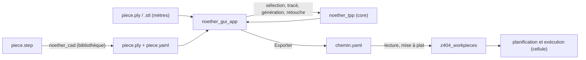

# Spécifications du fork Noether (Zone 404)

**Plateforme :** Zone 404
**Paquets :** `noether_cad` (bibliothèque C++ et ligne de commande ; aucun en-tête ROS dans le code), `noether_gui` (application Qt/VTK `noether_gui_app`), `noether_tpp` (bibliothèque de planification de chemins d'outil)
**Stack :** Noether 0.16.0 (ROS-Industrial), OpenCASCADE, VTK, PCL, Qt 5, yaml-cpp, Eigen
**Langue spec :** français | **Langue code :** anglais
**Versions :** V1 (existant), puis V1.1, V1.2… (ajouts à venir, chacun dans sa section)
**Statut :** V1 implémentée et testée, branche `z404/open-step`, commit `2dd5dfe`

---

## Comment lire ce document

Ce document est la spécification du fork Zone 404 de Noether : ce que nos ajouts font, ce
qu'ils refusent, et comment on le vérifie. Il ne décrit pas Noether d'origine, documenté
dans `docs/` (Doxygen) et sur le site du projet.

Il est découpé par version. La section **V1** décrit le code tel qu'il existe. Chaque ajout
de spec à venir prend une section **V1.1**, **V1.2**, etc., à la suite, sans réécrire V1 :
une règle de V1 remplacée y est barrée, avec un renvoi vers la version qui la remplace.

Les README des paquets (`noether_cad/README.md`, `noether_gui/README.md`) restent le mode
d'emploi détaillé. En cas de désaccord entre un README et ce document, ce document fait
foi et le désaccord se signale.

Les décisions sont numérotées `N1`, `N2`… dans le journal (annexe A). Les trous connus,
ce que le code ne tranche pas, sont dans l'annexe B.

---

## Table des matières

- [V1 : existant](#v1--existant)
  - [1. Contexte et rôle](#1-contexte-et-rôle)
  - [2. Vocabulaire](#2-vocabulaire)
  - [3. Principes directeurs](#3-principes-directeurs)
  - [4. Architecture générale](#4-architecture-générale)
  - [5. Conversion STEP (`noether_cad`)](#5-conversion-step-noether_cad)
  - [6. IHM : fenêtre et outils](#6-ihm--fenêtre-et-outils)
  - [7. Sélection des surfaces](#7-sélection-des-surfaces)
  - [8. Tracé manuel et génération](#8-tracé-manuel-et-génération)
  - [9. Retouche du chemin](#9-retouche-du-chemin)
  - [10. Couverture](#10-couverture)
  - [11. Fichiers produits](#11-fichiers-produits)
  - [12. Ajouts de `noether_tpp` hors IHM](#12-ajouts-de-noether_tpp-hors-ihm)
  - [13. Matrice d'erreurs](#13-matrice-derreurs)
  - [14. Structure des paquets et intégration](#14-structure-des-paquets-et-intégration)
  - [15. Critères d'acceptation](#15-critères-dacceptation)
  - [16. Résumé V1 / suite](#16-résumé-v1--suite)
- [Annexe A : journal des décisions](#annexe-a--journal-des-décisions)
- [Annexe B : trous connus](#annexe-b--trous-connus)

---

# V1 : existant

## 1. Contexte et rôle

Le fork sert à préparer, sur la CAO d'une pièce, le chemin d'un outil de ponçage à
disque, puis à l'exporter pour la cellule. Le chemin est dessiné par un opérateur : V1 ne
calcule pas de raster automatique depuis l'IHM.

### Ce qu'il fait

- Convertir un STEP en maillage en mètres, avec l'unité lue dans le fichier et une
  finesse imposée par l'appelant.
- Ouvrir une pièce STEP, PLY ou STL dans une IHM bilingue (français, anglais).
- Choisir des surfaces sur la pièce, face par face, avec quatre outils de sélection.
- Tracer à la main, sur chaque surface, la ligne que suit le centre de l'outil.
- Générer une passe par surface tracée : poses de contact au pas demandé, une pose
  d'approche et une de retrait.
- Retoucher le chemin : déplacer des poses, densifier un tronçon, réordonner et supprimer
  des passes, annuler.
- Mesurer et afficher la part de la surface atteinte par le disque.
- Exporter le chemin livré (poses), retouches appliquées.

### Ce qu'il ne fait pas

| Tâche | Responsable |
| --- | --- |
| Recaler la pièce réelle et transformer les poses dans le repère du robot | `z404_sdg_placement`, la vision (`scan3d`) |
| Lire le chemin exporté et le mettre à plat pour la planification | `z404_workpieces` (`tool_path.py`) |
| Calculer les articulations, vérifier l'atteignabilité et les collisions du robot | planification de la cellule (Tesseract) |
| Choisir la vitesse, l'effort et le réglage de la ponceuse | arbre de comportement et configuration de la cellule |
| Réparer ou décimer une géométrie CAO | hors périmètre (`noether_cad` §9) |
| Retirer les poses que l'outil n'atteint pas sans traverser la pièce | personne en V1 : `OcclusionModifier` existe mais n'est pas branché (§12, annexe B) |

### Invariants vérifiables

| Invariant | Vérification |
| --- | --- |
| Un STEP sans entité `LENGTH_UNIT`, ou avec plusieurs unités, est refusé | `StepReader.ParsesLengthUnitEntity`, `StepReader.ForcedUnitStillNeedsFileUnit` |
| Les déflexions de maillage n'ont pas de valeur par défaut ; nulle, négative, infinie ou NaN est refusée | `StepReader.RefusesInvalidDeflections`, `StepImport.RefusesMissingKeys`, `StepImport.RefusesNonFiniteOrNonNumeric` |
| Le recentrage est une translation pure, écrite dans la fiche YAML | `StepReader.RecentersOnBoundingBox` |
| Chaque pose de contact a son axe z sur la normale de la face et son axe x dans le sens de marche | `TraceTool.PosesFollowTheNormalAndTheTravel`, `TraceTool.StraightensTheTravelAgainstATiltedNormal` |
| L'approche et le retrait sont à la hauteur demandée le long de l'axe z de la première et de la dernière pose de contact | `TraceTool.ApproachAndRetractStandAboveTheEnds`, `TraceTool.ApproachFollowsATiltedToolAxis` |
| Une passe livrée porte au moins 4 poses ; sinon l'export est refusé | `ToolPathRecipe.ValidationRefusesAPassShorterThanTheContract`, `PathEditWidget.ReportsAPassTooShortToDeliver` |
| La recette n'invente aucune pose : toute pose livrée vient de la génération, d'un déplacement ou d'une densification enregistrés | `ToolPathRecipe.NoWaypointIsInventedByTheHandEdit` pour la recette seule ; revue de `assemblePasses` pour les déplacements et insertions, non testés sur ce point |
| Un fichier de retouche de version supérieure à 3 est refusé | lecture de `readRecipeFile`, `ToolPathRecipe.RefusesAMalformedRecipeFileNamingIt` |
| L'approche et le retrait ne comptent pas dans la couverture | `FaceCoverage.TheApproachAndDepartureDoNotCount` |
| Les textes de l'IHM (onglets, outils, options, boîtes de dialogue) existent en français et en anglais | `Translator.*`, `ProcessRibbon.Translates` ; exceptions listées en §6.4 |

## 2. Vocabulaire

| Terme | Définition |
| --- | --- |
| pièce | le maillage chargé dans la vue, en mètres |
| face | un triangle du maillage. À ne pas confondre avec la **face CAO**, surface du STEP dont plusieurs triangles proviennent |
| sélection en cours | les faces choisies et pas encore validées, dessinées en orange |
| surface | un ensemble de faces d'un seul tenant, validé, qui porte au plus un tracé et produit au plus une passe |
| tracé | la polyligne posée à la main sur une surface, que suit le centre de l'outil |
| pose | position et orientation de l'outil : z sur la normale de la face, x dans le sens de marche. Pour un STEP, la normale sort de la matière (`noether_cad`) ; pour un PLY ou un STL, son sens est celui du fichier, l'IHM ne la réoriente pas |
| pose de contact | une pose posée sur la pièce, qui ponce |
| approche, retrait | la pose hors contact devant la première et derrière la dernière pose de contact d'une passe |
| passe | une suite continue de poses, approche et retrait compris, que l'outil parcourt sans quitter la pièce |
| génération | les passes produites par **Générer**, avant toute retouche |
| retouche | ce que l'opérateur change après la génération : ordre, suppressions, poses déplacées, poses ajoutées |
| recette | la forme déclarative d'une retouche, tenue en mémoire par l'IHM (`PathEditWidget`) |
| chemin livré | la génération à laquelle la retouche est appliquée ; c'est ce qu'exporte **Exporter** |
| couverture | la part de l'aire des surfaces que le disque atteint en suivant le chemin |

Termes proscrits : « trajectoire » pour une passe (la trajectoire du robot est calculée
ailleurs) ; « segment » pour une passe dans le texte destiné à l'opérateur (c'est le nom de
la passe dans le code, `ToolPathSegment`). Le mot reste employé, dans l'aide du tracé, au
sens géométrique d'une ligne droite entre deux sommets.

## 3. Principes directeurs

1. **Rien de deviné.** L'unité d'un STEP est lue dans le fichier, la finesse du maillage
   et la hauteur d'approche sont données par l'appelant, la tolérance de comparaison d'une
   recette est passée par l'appelant. *Conséquence :* un STEP sans fichier de finesse est
   refusé à l'ouverture (§5), et aucune de ces fonctions n'a d'argument par défaut.
2. **L'opérateur dessine le chemin.** En V1, **Générer** transforme le tracé en poses, il
   ne planifie pas de raster. *Conséquence :* une surface sans tracé ne produit rien, et
   le rapporte (§8).
3. **Une passe ne s'interrompt pas.** L'outil ne quitte pas la pièce au milieu d'une
   passe. *Conséquence :* une surface donne une seule passe ; une sélection en plusieurs
   morceaux est refusée (§7).
4. **La retouche est déclarative.** Elle se tient en recette, pas en suite d'actions.
   *Conséquence :* Annuler revient à l'état précédent sans rejouer d'actions, et une
   recette appliquée à une autre génération est détectée par les empreintes des passes (§9).
5. **Une IHM, deux langues.** *Conséquence :* chaque texte passe par la classe
   `Translator` ; un texte calculé est recalculé au changement de langue, sauf les
   exceptions de §6.4.

## 4. Architecture générale



Frontières :
- `noether_cad` n'expose aucun type OpenCASCADE ; l'IHM et `noether_tpp` ne voient que des
  triangles.
- L'IHM n'écrit rien dans le repère du robot. Les poses exportées sont dans le repère du
  maillage, en mètres. Pour un STEP, c'est le repère recentré dont la translation est
  écrite dans `piece.yaml` (`T_source_output`).
- Le chemin exporté ne porte ni vitesse, ni effort, ni outil.

## 5. Conversion STEP (`noether_cad`)

La règle complète est dans `noether_cad/README.md` ; ce qui suit en est le contrat.

| Règle | Motif |
| --- | --- |
| L'unité est lue dans l'entité `LENGTH_UNIT` de la section DATA ; absente ou multiple : refus | une unité devinée donne une pièce mille fois trop grande ou trop petite, sans erreur |
| Mise en mètres **avant** le maillage | une déflexion en mètres appliquée à un modèle en millimètres donne un maillage mille fois trop fin |
| `linear_deflection_m` et `angular_deflection_rad` obligatoires, strictement positives et finies | la finesse est un choix d'ingénierie : trop grossière, la corde passe sous la surface |
| Un fichier à plusieurs solides est refusé si l'appelant n'a pas choisi (`solids: one`) | l'outil ne choisit pas à la place de l'opérateur |
| Recentrage par translation pure vers le centre de la boîte englobante des triangles, écrite dans la fiche | sans elle, ce qui est mesuré sur la pièce réelle ne se rattache plus au maillage |
| Chaque triangle garde l'identifiant de sa face CAO | sélectionner une face CAO revient à extraire un intervalle de triangles |
| Le `.ply` et le `.yaml` déjà présents sous le même préfixe sont remplacés sans confirmation | la conversion est rejouable à l'identique |

Dans l'IHM, la finesse vient d'un fichier YAML passé au lancement (`--step-tessellation`,
`-s`), relu à chaque ouverture :

```yaml
linear_deflection_m: <mètres>
angular_deflection_rad: <radians>
solids: all          # ou one
```

Le PLY et sa fiche s'écrivent à côté du STEP. L'IHM n'impose jamais l'unité.

## 6. IHM : fenêtre et outils

### 6.1 Disposition

Barre du process en haut (onglets et outils), arbre à gauche, vue 3D au centre, options à
droite, barre d'état en bas. La barre d'outils et le dock de configuration du pipeline
d'origine sont cachés ; leurs actions restent dans les menus. Schéma et classes :
`noether_gui/README.md` §1.

### 6.2 Onglets

| Onglet | Outils | Options |
| --- | --- | --- |
| 1 Fichier | Ouvrir une pièce, Reprendre un chemin | formats acceptés, finesse STEP |
| 2 Sélection | Région, Brosse, Polygone, Gomme, Valider la surface | angle de planéité, diamètre de la brosse |
| 3 Traitement | Tracé manuel, Générer, Déplacer des points, Densifier | pas du tracé, hauteur d'approche, rayon de l'outil, pas cible de densification |
| 4 Trajectoire | Ordre des passes, Exporter | liste des passes : monter, descendre, supprimer, annuler |
| Affichage | Calques, Vues standard, Langue | disques pleins, surélévation, zones non couvertes ; vues face, dessus, côté, iso |

Règles :
- Les outils qui prennent la souris dans la vue s'excluent : en choisir un relâche le
  précédent.
- Un outil de sélection est toujours armé. Tracé manuel, Déplacer des points et Densifier
  sont temporaires : ils rendent la souris au dernier outil de sélection quand on change
  d'outil, quand on valide la disposition, ou quand on entre dans les onglets Fichier,
  Trajectoire ou Affichage.
- Changer d'onglet ne lance aucune action, sauf : l'onglet Sélection reprend le dernier
  outil de sélection, l'onglet Traitement active le Tracé manuel.

### 6.3 Gestes de vue

| Geste | Effet |
| --- | --- |
| clic droit et glisser | tourner, quel que soit l'outil |
| Alt + clic gauche et glisser | tourner, avec un outil qui utilise le glisser |
| molette | zoom |

### 6.4 Langue

Français par défaut, anglais au choix (Affichage, Langue), gardé dans `QSettings` (clé
`language`, valeurs `fr`, `en`). Ne changent pas de langue : le titre de la fenêtre, un
message déjà affiché dans la barre d'état, les messages d'erreur des bibliothèques (dont
les défauts de retouche de `noether_tpp`, en anglais seul), et la ligne « N poses » de la
liste des passes, en français seul (annexe B).

### 6.5 Valeurs à l'ouverture

| Réglage | Valeur | Source |
| --- | --- | --- |
| diamètre de la brosse | 30 mm | `kDefaultBrushDiameterMm` |
| angle de planéité (Région) | 20° | `kDefaultFlatnessAngleDeg` |
| pas du tracé | 20 mm | `kDefaultTraceStepMm` |
| hauteur d'approche et de retrait | 50 mm | `kDefaultApproachHeightMm` |
| rayon de l'outil | 62,5 mm (disque de 125 mm) | `kDefaultToolRadiusMm` |
| pas cible de densification | 10 mm | `kDefaultDensifyStepMm` |
| surélévation des disques dessinés | 2 mm | `kDefaultDiscLiftMm` |

Ce sont des valeurs de départ de champs que l'opérateur modifie, pas des valeurs par
défaut d'une fonction (principe 1). Elles sont dans
`noether_gui/src/widgets/tpp_widget_defaults.h`.

## 7. Sélection des surfaces

| Outil | Règle |
| --- | --- |
| Région | depuis la face cliquée, ajoute les faces voisines par une arête tant que l'angle entre la normale d'une face et celle de sa voisine reste sous l'angle de planéité. Ne traverse pas les faces d'une surface déjà validée |
| Brosse | ajoute les faces à moins d'un demi-diamètre, en distance mesurée le long de la surface (`facesWithinGeodesicRadius`), pas à vol d'oiseau. Le glisser est échantillonné pour ne pas laisser de pointillés |
| Polygone | clics successifs dans la vue ; Entrée ferme le contour, Retour arrière retire le dernier sommet, Échap efface. Ajoute les faces dont le centroïde projeté est dans le contour |
| Gomme | retire des faces de la sélection en cours. Avec Maj, Brosse et Polygone effacent au lieu d'ajouter. Région n'a pas d'effacement par Maj : un clic sur une zone orange la retire, avec ou sans Maj |

**Valider la surface** transforme la sélection en cours en surface. Elle est refusée si
la sélection est vide, ou faite de plusieurs morceaux non reliés par une arête (principe 3).

Dans l'arbre :
- **Reprendre** remet les faces de la surface dans la sélection en cours ; son tracé est
  perdu.
- **Supprimer** retire la surface et son tracé.
- Une **case décochée** dessine la surface comme des faces libres ; elle est toujours
  générée.

**Rognage à l'affichage.** Avec « Rayon de l'outil » coché, une surface est dessinée
rognée du rayon d'outil le long des bords où une face voisine monte au-dessus d'elle
(un relief que le disque heurterait). Ce rognage ne change que l'affichage : il ne retire
aucune face de la surface et ne change pas la génération.

## 8. Tracé manuel et génération

**Tracé manuel.** Il s'applique à la surface courante de l'arbre. Le premier clic pose le
départ ; chaque clic ou chaque glisser ajoute un sommet au point de relâche. Retour arrière
retire le dernier sommet, Échap efface le tracé. Les mêmes actions existent en boutons.

**Générer.** Pour chaque surface qui a un tracé d'au moins deux sommets :

1. la polyligne est échantillonnée au pas du tracé, en reportant la longueur d'arc d'un
   segment au suivant ; le premier et le dernier sommet sont toujours gardés
   (`sampleTrace`) ;
2. chaque point est projeté sur la surface, avec la normale de la face touchée ;
3. chaque pose prend z sur la normale et x dans le sens de marche rendu orthogonal à z
   (`tracePoses`) ;
4. une pose d'approche et une de retrait sont ajoutées à la hauteur d'approche, le long de
   l'axe z de la première et de la dernière pose de contact (`withApproachAndRetract`).

Une surface donne une passe. Une surface sans tracé ne donne rien et la liste des
surfaces concernées est affichée. Une sélection en cours non validée bloque la génération.

Si le chemin porte une retouche, une nouvelle génération demande confirmation : elle la
perd, parce qu'elle renumérote les passes. Si la génération échoue en cours de route, tout
le résultat partiel est effacé, pour ne pas afficher ni exporter un chemin amputé.

## 9. Retouche du chemin

### 9.1 Déplacer des points

Le glisser d'une pose de contact la déplace sur la pièce : z suit la normale de la face
sous le curseur, x garde son sens de marche rendu orthogonal. Si la pose déplacée est la
première ou la dernière de contact, l'approche ou le retrait la suit, à la même place dans
son repère. Un clic à plus de 50 mm de toute pose ne saisit rien (`kGrabToleranceM`).
L'approche et le retrait ne se saisissent pas. **Annuler** défait un glisser entier.

### 9.2 Densifier

1. Choisir deux poses de contact A et B de la même passe (clic à moins de 50 mm).
2. Régler le pas cible.
3. Cliquer **Densifier**.

Chaque écart entre deux poses voisines, de A à B, plus long que le pas cible, reçoit des
poses régulièrement réparties, projetées sur la face la plus proche du maillage entier et
orientées comme celles du tracé. Les poses existantes ne bougent pas. Redensifier le même
écart remplace les poses ajoutées. Densifier demande la pièce ouverte : un chemin repris
sans sa pièce est refusé. Les poses ajoutées ne suivent pas un déplacement ultérieur de
leurs voisines, et ne se saisissent pas avec Déplacer des points.

### 9.3 Ordre des passes

Onglet Trajectoire : choisir une passe dans la liste, puis monter, descendre, supprimer,
annuler. **Annuler** défait le dernier changement, une densification comprise.

Les fonctions retourner, souder, scinder, enchaîner et revenir à la génération existent
dans `PathEditWidget` et `tool_path_recipe`, mais leurs boutons sont cachés en V1
(`hideAdvancedControls`). Une soudure retire une pose de chaque côté du raccord, l'approche
et le retrait, pour que l'outil reste en contact.

### 9.4 Recette

La retouche s'écrit en recette (`RecipeFile`) :
- `recipe` : pour chaque passe livrée, la liste des passes générées qu'elle met bout à bout,
  chacune avec son sens ;
- `source` : l'empreinte de chaque passe générée (nombre de poses, position de la première
  et de la dernière) ;
- `moves` : les poses déplacées, repérées par leur passe et leur rang dans la génération ;
- `insertions` : les poses ajoutées, repérées par le rang de la pose qui les précède.

Ordre d'application : déplacements, puis insertions, puis recette. Un déplacement ou une
insertion qui désigne une pose qui n'existe plus est ignoré ; pour une même place, le
dernier gagne.

## 10. Couverture

Une zone est couverte quand elle est à moins du rayon d'outil d'un tronçon reliant deux
poses voisines d'une passe. Le disque balaie le tronçon : ce n'est pas seulement l'union
des cercles dessinés. L'approche et le retrait ne comptent pas.

| Moment | Ce qui est mesuré | Contre quoi |
| --- | --- | --- |
| pendant le Tracé manuel | le tracé de la surface courante | cette surface |
| après génération | le chemin livré, retouches comprises | toutes les surfaces tracées |

- Les faces sont découpées en cellules d'au plus un sixième du rayon d'outil
  (`kCoverageCellsPerRadius = 6`), pour que le résultat ne dépende pas de la taille des
  triangles. Au-delà de 200 000 cellules (`kMaxCoverageCells`), les cellules sont agrandies.
- La mesure est refaite à la fin d'un glisser, et seulement si le chemin, les faces ou le
  rayon ont changé.
- Les zones non couvertes sont dessinées en vert citron. La barre d'état donne la part
  couverte de l'aire et l'aire non couverte.
- Aucun seuil de couverture n'est imposé en V1 : la valeur est affichée, pas jugée
  (annexe B).

## 11. Fichiers produits

### 11.1 `<nom>.yaml` : le chemin livré

Écrit par **Exporter**, refusé si aucune génération n'existe ou si la retouche a un défaut
(passe de moins de 4 poses, recette incohérente), avec la liste des défauts.

- Format : la sérialisation YAML de `std::vector<ToolPaths>` de Noether, des listes
  imbriquées. La liste la plus interne est une passe, suite de poses.
- Une pose : position en mètres et quaternion, dans le repère du maillage.
- Les lecteurs parcourent l'imbrication à profondeur libre et lisent les passes dans
  l'ordre du fichier (`flattenToolPaths` ici, `tool_path.py` de `z404_workpieces`).
- Chaque passe commence par l'approche et finit par le retrait.

### 11.2 Pas de fichier de retouche

**Exporter** n'écrit que le chemin livré. La recette des retouches n'est pas exportée
(N10) : l'IHM ne la relirait pas, et le tracé qui permettrait de refaire la même
génération n'est pas enregistré. **Reprendre un chemin** charge le `.yaml` comme une
nouvelle génération, sans retouche.

La lecture et l'écriture d'un fichier de recette restent dans la bibliothèque
(`readRecipeFile`, `writeRecipeFile`, `schema_version: 3`, versions 1 et 2 encore lues,
version supérieure refusée), avec leurs tests, sans appelant dans l'IHM.

### 11.3 `<piece>.ply` et `<piece>.yaml`

Produits par la conversion STEP (§5). Format de la fiche : `noether_cad/README.md` §4.

## 12. Ajouts de `noether_tpp` hors IHM

| Élément | Fichier | Rôle | Utilisé par l'IHM V1 |
| --- | --- | --- | --- |
| sélection de faces | `core/face_selection.h` | graphe des voisines par arête, normales et centroïdes, distance le long de la surface, point dans un polygone, fusion et effacement de régions | oui (§7) |
| couverture | `core/face_coverage.h` | `computeCoverage` : faces qu'aucun tronçon n'approche à moins du rayon | oui (§10), sur les cellules découpées |
| recette | `core/tool_path_recipe.h` | mise à plat, assemblage, validation, empreintes, déplacements, insertions, soudure, enchaînement, lecture et écriture de la recette | oui (§9) ; la lecture et l'écriture du fichier n'ont pas d'appelant (§11.2) |
| `CurvatureThreshold` | `mesh_modifiers/curvature_threshold_modifier.h` | garde la partie du maillage dont la courbure est sous un seuil (moyenne, gaussienne, principale max ou min). Pour un disque de diamètre D, seuil 2/D, soit 16 m⁻¹ pour 125 mm | non. Déclaré comme plugin, utilisable dans une configuration de pipeline |
| `StartEndOrganization` | `tool_path_modifiers/start_end_organization_modifier.h` | ordonne et oriente les lignes d'un raster pour partir près d'un point et finir près d'un autre ; `endGap` donne l'écart restant | non. Déclaré comme plugin ; branché dans `TPPPipelineWidget`, que la génération V1 n'appelle pas |
| `OcclusionModifier` | `tool_path_modifiers/occlusion_modifier.h` | retire les poses dont l'axe outil, le bord du disque ou un rayon radial rencontre le maillage complet ; coupe la passe autour des poses retirées et abandonne les morceaux trop courts | non. Pas déclaré comme plugin |

## 13. Matrice d'erreurs

Le fork ne lève pas de codes `z404_error` : ce sont des exceptions standard, présentées à
l'opérateur par une boîte de dialogue.

| Composant | Situation | Réaction |
| --- | --- | --- |
| `noether_cad` | unité absente ou multiple, solides non choisis, déflexion invalide, fichier illisible | exception ; la CLI sort avec le code 2, 3 ou 4 ; l'IHM affiche le message et ne charge rien |
| IHM, ouverture | STEP sans fichier de finesse, fichier de finesse incomplet ou invalide | ouverture refusée, message |
| IHM, Valider la surface | sélection vide ou en plusieurs morceaux | refus, message, sélection gardée |
| IHM, Générer | sélection en cours non validée | refus, message |
| IHM, Générer | surface sans tracé | les autres sont générées ; liste des surfaces sans tracé |
| IHM, Générer | exception pendant la génération | résultat partiel effacé, message |
| IHM, Générer | retouche en cours | confirmation demandée, Non par défaut |
| IHM, Exporter | aucune génération, ou retouche invalide | export refusé, liste des défauts |
| IHM, Reprendre un chemin | fichier qui ne se lit pas comme un chemin | refus, message nommant le fichier |
| IHM, Densifier | pièce absente | refus |
| `readRecipeFile` | fichier absent, mal formé, version inconnue | `std::runtime_error` qui nomme le fichier |
| `assemblePasses` | index hors limites, passe utilisée deux fois, entrée vide | `std::runtime_error` |

## 14. Structure des paquets et intégration

```
noether/
├── SPECIFICATIONS.md          ce document
├── noether_cad/               conversion STEP -> PLY + fiche (ajout Zone 404)
│   ├── include/noether_cad/   cad_model.h, step_reader.h, mesh_writer.h
│   ├── src/                   bibliothèque, src/app/noether_cad.cpp (CLI)
│   └── test/step_reader_utest.cpp
├── noether_gui/               IHM, noether_gui_app
│   ├── src/widgets/           tpp_widget*.cpp, path_edit_widget, process_ribbon,
│   │                          trace_tool, outline_tool, step_import, translator
│   ├── resources/icons/       icônes des outils (SVG)
│   └── test/                  6 exécutables de test
└── noether_tpp/               planification ; ajouts : core/face_*, core/tool_path_recipe,
                               3 modificateurs, et leurs tests
```

Dépendance de build : `noether_tpp` ← `noether_gui` → `noether_cad`. `noether_cad` ne
dépend pas de `noether_tpp`. Son code n'inclut aucun en-tête ROS ; sa compilation demande
seulement `ros_industrial_cmake_boilerplate`, comme les autres paquets de Noether.

Build : colcon dans le workspace (`src/z404_external_dependencies/noether`), tests avec
`-DNOETHER_ENABLE_TESTING=ON` puis `ctest`. Images Docker Linux et Windows : dépôt
`z404-docker-images`, branche `feat/noether-images`.

Lancement :

```bash
noether_gui_app -s <finesse.yaml> [-m <piece.step|ply|stl>] [-c <pipeline.yaml>]
```

## 15. Critères d'acceptation

Tous cochés : le test nommé passe sur `2dd5dfe` plus le retrait de l'export `.edits.yaml` (N10), en Release, le 31/10/2026 : noether_cad 21/21, noether_tpp 131/131, noether_gui 57/57.

### Conversion STEP
- [x] STEP en millimètres → sommets en mètres (`StepReader.ConvertsMillimetersToMeters`)
- [x] Unité absente ou multiple → refus (`StepReader.ParsesLengthUnitEntity`)
- [x] Unité imposée sur un fichier sans unité → refus (`StepReader.ForcedUnitStillNeedsFileUnit`)
- [x] Plusieurs solides sans choix → refus qui liste les solides (`StepReader.SelectsSolids`, `StepReader.RefusesInvalidSolidSelection`)
- [x] Déflexion nulle, négative, infinie ou NaN → refus (`StepReader.RefusesInvalidDeflections`)
- [x] Fichier de finesse sans clé obligatoire → refus (`StepImport.RefusesMissingKeys`)

### Tracé et génération
- [x] Pas nul ou négatif → refus (`TraceTool.RefusesAStepThatMeansNothing`)
- [x] Tracé droit → un point par pas, sans doublon à l'arrivée (`TraceTool.PlacesAPointEveryStepAlongAStraightLine`, `TraceTool.DoesNotRepeatAnArrivalThatFallsOnAStep`)
- [x] Angle dans le tracé → le pas est tenu à travers l'angle (`TraceTool.KeepsTheSpacingAcrossACorner`)
- [x] Hauteur d'approche nulle ou aucune pose de contact → refus (`TraceTool.RefusesApproachWithoutContactOrHeight`)

### Retouche
- [x] Passe livrée de moins de 4 poses → export refusé (`PathEditWidget.ReportsAPassTooShortToDeliver`)
- [x] Recette écrite sur une autre génération → refus (`PathEditWidget.RefusesARecipeWrittenOnAnotherGeneration`) ; testé dans la bibliothèque, pas atteignable depuis l'IHM V1 (§11.2)
- [x] Fichier de version 1 ou 2 → lu sans le champ manquant (`PoseMoves.AVersionOneFileReadsWithoutMoves`, `PoseInsertions.AVersionTwoFileReadsWithoutInsertions`)
- [x] Annuler après un glisser → tout le glisser est défait (`PathEditWidget.MovesAPoseAndUndoesTheWholeDragAtOnce`)
- [x] Redensifier le même écart → les poses ajoutées sont remplacées (`PathEditWidget.ADensifiedPlaceIsReplacedAndANewGenerationForgetsIt`)

### Couverture
- [x] Deux passes espacées de 100 mm, disque de 125 mm → tout couvert (`FaceCoverage.TwoPassesAtTheDiscDiameterCoverEverything`)
- [x] Approche et retrait → ne couvrent rien (`FaceCoverage.TheApproachAndDepartureDoNotCount`)
- [x] Rayon nul ou négatif → refus (`FaceCoverage.RefusesWhatItCannotMeasure`)

### Langue
- [x] Changement de langue → toutes les liaisons sont rejouées, la langue est gardée (`Translator.ReplaysBindings`, `Translator.SavesLanguage`)

### Sans test automatique, contrôle à l'écran
- [ ] Sélection en plusieurs morceaux → Valider refusé
- [ ] Génération avec retouche → confirmation, Non par défaut
- [ ] Disposition de la fenêtre, disques, couche des zones non couvertes

## 16. Résumé V1 / suite

| | V1 (cette section) | Suite |
| --- | --- | --- |
| Chemin | dessiné à la main, une passe par surface | V1.1 et suivantes, au fil des ajouts de spec |
| Couverture | mesurée et affichée, sans seuil | |
| Retouche | appliquée au chemin exporté, recette non exportée | |
| Occlusion, courbure, ordre départ/arrivée | codés dans `noether_tpp`, pas dans l'IHM | |

---

## Annexe A : journal des décisions

| N° | Décision | Motif |
| --- | --- | --- |
| N1 | Le STEP n'a pas de finesse par défaut ; l'IHM la lit dans un fichier passé au lancement | une finesse est un choix d'ingénierie ; une valeur cachée produit un maillage faux sans erreur |
| N2 | PLY et STL chargés tels quels, supposés en mètres | ils ne portent pas d'unité ; l'étendue affichée dans la barre d'état est le contrôle |
| N3 | En V1, Générer transforme le tracé en poses et ne planifie pas de raster | IHM « tout manuel » (commit `4950dbb`) : le chemin suit ce que l'opérateur a dessiné |
| N4 | Une surface est d'un seul tenant et donne une seule passe | une passe ne s'interrompt pas ; découper en silence cacherait des approches et des retraits |
| N5 | La retouche est une recette déclarative avec empreintes, et non une suite d'actions | une suite d'actions renumérote ses propres étapes et devient ambiguë à rejouer |
| N6 | Une soudure retire l'approche et le retrait au raccord | les garder ferait décoller l'outil au milieu d'une passe |
| N7 | Les poses ajoutées par densification sont enregistrées complètes et ne suivent pas leurs voisines | elles restent telles qu'elles ont été posées sur la pièce |
| N8 | Les boutons retourner, souder, scinder, enchaîner et revenir sont cachés en V1 | IHM simplifiée (commit `4950dbb`) ; le code et ses tests restent |
| N9 | Couverture mesurée sur des cellules d'un sixième du rayon, et non sur les triangles | le résultat ne doit pas dépendre de la finesse du maillage |
| N10 | Exporter n'écrit plus `<nom>.edits.yaml` | décision utilisateur du 31/10/2026 : le fichier n'était relu par rien, et sans le tracé enregistré la recette ne se rejoue pas |

## Annexe B : trous connus

| Trou | État |
| --- | --- |
| Seuil de couverture minimale | aucun ; à fixer par l'utilisateur |
| Reprise d'un chemin avec ses retouches | impossible : ni le tracé ni la recette ne sont enregistrés ; `readRecipeFile` et `applyRecipeFile` existent sans appelant |
| `OcclusionModifier` | codé et testé, ni plugin ni branché : une passe sous un recouvrement n'est pas détectée |
| `StartEndOrganization` et `CurvatureThreshold` | plugins disponibles pour une configuration de pipeline ; la génération V1 ne passe pas par le pipeline |
| Configuration de pipeline `-c` | chargée dans le dock caché ; sans effet sur la génération V1 |
| Région | compare chaque face à sa voisine, pas à la face de départ : sur une courbure lente, la région peut faire le tour de la pièce |
| Contrôle à l'écran (§15) | pas de test automatique de la disposition ni du dessin |
| Textes non traduits | la ligne « N poses » de la liste des passes est en français seul et ne change pas de langue ; les défauts de retouche affichés à l'export viennent de `noether_tpp`, en anglais seul |
